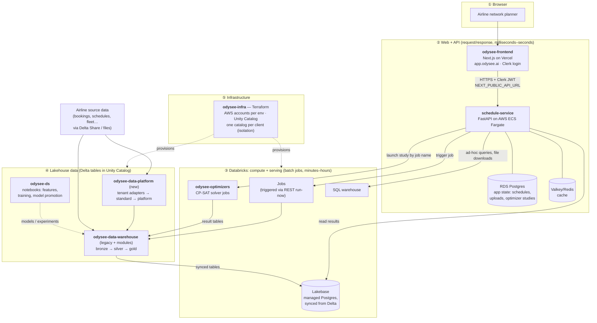
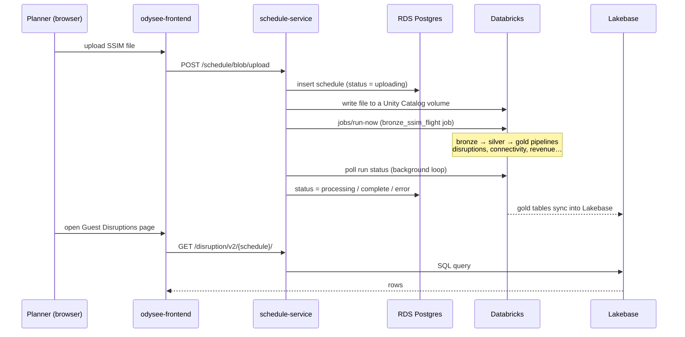
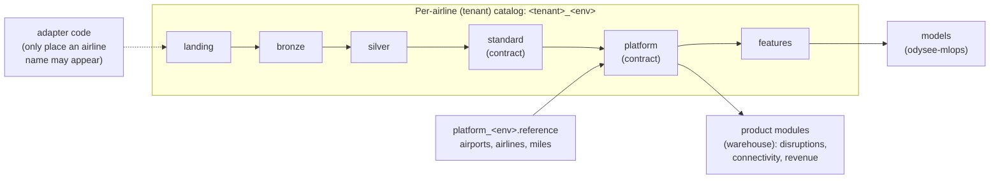

# 01 — System overview

*Written 2026-11-03 from reading the seven repos. Confidence markers: **[code]** = seen in code or
config, **[docs]** = a README/ADR says so, **[inferred]** = my reading, verify with a human.*

## What the product is, in one paragraph

Odysee (internal codename **Sierra** — every Jira ticket is `SIERRA-nnnn`) sells airline
**network planners** a tool for evaluating flight schedules. A planner uploads a proposed
schedule (an industry-standard **SSIM** file). The system compares it against what the airline
actually flies and sells, and answers questions like: *which booked passengers get disrupted by
this change, and what can we rebook them onto?* (Guest Disruptions), *which connections does this
schedule create or break, and what are they worth?* (Connectivity Intelligence), *what revenue
will this schedule produce?* (Revenue Prediction / Attribution), and *can a solver find a better
schedule under these constraints?* (Optimizers). **[docs + code]**

The first and main customer is **Alaska Airlines** — catalogs are literally named
`alaska_sierra_<env>_catalog`. **JSX** appears as a demo/onboarding carrier, and there are
New Zealand model notebooks in `odysee-ds`. **[code]**

## The picture: five layers

Think of it as a classic web app (top two layers) bolted onto a data warehouse (bottom three).
The interesting part is the seam between them.

### How to read it, if you come from MySQL-backed web apps

- Layers ①–② are familiar: a JS front end, a Python API, a Postgres (RDS = AWS's hosted
  MySQL/Postgres) for application state, and a Redis-compatible cache.
- Layers ③–④ are the unfamiliar part. **Databricks** is a hosted Spark platform: think of it as
  "a cron + a giant distributed SQL/Python engine + a filesystem of columnar tables". Tables are
  **Delta** tables (Parquet files plus a transaction log, sitting in S3), organised by
  **Unity Catalog** into a three-part name `catalog.schema.table`.
- The API **never computes heavy results itself**. It kicks off a Databricks job, records "in
  progress" in its own Postgres, and later reads the finished results.
- Those results are read from **Lakebase** — Databricks' managed Postgres. Gold Delta tables are
  continuously *synced* into it (`odysee-data-warehouse/resources/*_sync.tf`) so the API can do
  fast, indexed, row-level lookups instead of firing a Spark query per HTTP request. If you've ever
  maintained a MySQL read replica fed by an ETL out of a warehouse, this is that. **[code]**

## The two flows that matter

### Flow A — uploading a schedule (async, long-running)

Sources: `schedule-service/schedule_service/services/ssim_upload.py`,
`.../services/databricks_workflow_service.py` (raw REST `POST /api/2.1/jobs/run-now`),
`.../settings.py:54` (`DATABRICKS_BRONZE_SSIM_FLIGHT_JOB_ID`), `ENABLE_DATABRICKS_WORKFLOW_TRIGGER`
in the README. **[code]** The exact chain of jobs after SSIM ingest I have *not* traced yet — that's a
good next deep dive. **[inferred]**

### Flow B — running an optimizer study

Same shape, but the contract is tighter and better documented:

1. `POST` to the optimizer API → schedule-service finds the Databricks job **by name**
   (`optimizer-schedule-{env}`, `optimizer-constraints-{env}`, `optimizer-gauge-{env}`;
   `settings.py:88-90`) and launches it with typed parameters.
2. The job writes a **progress JSON** file the service polls, then result tables in
   `{catalog}.ai.*`.
3. Each optimizer writes a **readiness marker** table *last*, so the API never reads half-written
   results. The parameter and result schemas are Pydantic models in
   `odysee-optimizers/src/odysee_optimizers/contracts/` — that's the API contract between the two
   repos. **[docs + code]**

## The repositories, placed on the map

| Layer | Repo | Language / tools | Deploys to | Maturity (my read) |
|---|---|---|---|---|
| ② | **odysee-frontend** | TypeScript, Next.js 15, React 19, MUI, TanStack Query, Turborepo/pnpm | Vercel; `develop`→dev, `release/*`→staging+demo, `main`→prod | Active; big (≈1.2k files) |
| ② | **schedule-service** | Python 3.12, FastAPI, SQLAlchemy/Alembic, Poetry | AWS ECS Fargate (Terraform in `infra/`); `main`→dev, tags→staging/demo/prod | Working, carrying debt: lint/mypy only enforced on 57/120 files |
| ③ | **odysee-optimizers** | Python, OR-Tools CP-SAT, uv, Databricks Asset Bundles | Databricks jobs; release-please, `/rc` → staging+demo | Cleanest repo; strong contracts |
| ④ | **odysee-data-warehouse** | PySpark, Delta Live Tables, Terraform for jobs | Databricks (4 AWS workspaces: dev/staging/prod/demo) | Large legacy core (~218 pipeline files, ~175 `.tf` job defs). README is a stale template. |
| ④ | **odysee-data-platform** | PySpark, serverless jobs, Terraform, data contracts | Databricks; Terraform Cloud applies | New; dev only so far. Target architecture. |
| ④ | **odysee-ds** | Jupyter notebooks | Manually, it seems | Research lab; no packaging/CI |
| ⑤ | **odysee-infra** | Terraform, OPA policies, AWS Control Tower | AWS org + Databricks account | "Foundation only" per its own README; heavy ADR culture (35 ADRs) |
| — | *odysee-mlops* | — | — | Referenced by infra/data-platform ADRs as owner of models; **not in our access list** |

## The big thing in motion: two migrations at once

This is the single most important context for understanding why the repos look inconsistent.

**1. Cloud: Azure → AWS.** The original Databricks workspace was on Azure
(`odysee-data-warehouse/README.md` still points at `*.azuredatabricks.net`). Today the warehouse
and optimizers deploy to AWS workspaces (`*.cloud.databricks.com` in
`odysee-data-warehouse/resources/environments/*.tfvars`, `odysee-optimizers/databricks.yml`).
A temporary export stack moves data out of Azure (`odysee-infra/stacks/migration-export`, expiring
2026-11-18). **[code + docs]**

**2. Architecture: single-client monolith → multi-tenant platform.** The warehouse was built for
Alaska alone: catalog names, carrier codes and business rules (Mileage Plan valuation, QX/OO→AS
carrier remaps) are hard-coded throughout. The new design separates that into:

- **odysee-data-platform** owns everything up to `platform`/`features`: per-airline *adapters*
  that translate each airline's raw data into a common `standard` shape, then tenant-agnostic code
  that builds shared products. Every published table has a versioned contract; CI fails if an
  airline name appears outside its adapter.
- **odysee-data-warehouse** keeps the product modules, Lakebase serving and the per-schedule
  orchestrator.
- `odysee-data-platform/MIGRATION.md` is the move list, pipeline by pipeline, prioritised P0–P3.
  A pipeline moves only after running in parallel and reconciling against the old output.

**Isolation model (infra):** AWS account = environment boundary (dev / staging / prod / demo /
ml-prod). Unity Catalog **catalog = client boundary**: each airline gets its own S3 bucket, KMS
key, IAM role, catalog and service principal, and jobs run *as* that principal. Adding a client is
meant to be one entry in `odysee-infra/registry/tenants.yaml`. The infra README is candid that
isolation is currently enforced by review, not by tests. **[docs]**

## Honest observations

- **Docs quality is uneven.** infra, data-platform and optimizers are unusually well documented
  (ADRs, rationale, "what got worse"). The warehouse README is an unedited Databricks template, and
  its AGENTS.md *forbids* docs files. Trust code over README in the warehouse.
- **Docs drift.** `odysee-infra/README.md` says "this repository has created no Databricks
  workspace", yet four AWS workspaces exist and are in use. Likely created outside that repo, or
  the README is behind — see open questions.
- **Branching differs per repo**: frontend uses `develop`/`release/*`/`main`; schedule-service
  and infra deploy dev from `main` and higher envs from tags; optimizers use release-please +
  `/rc`. Check each repo's README before you open a PR.
- **Per-repo AI rules differ.** e.g. the warehouse AGENTS.md forbids `Co-Authored-By` trailers and
  tool attribution in commits/PRs; the frontend CLAUDE.md says never commit without permission.

## Suggested next deep dives (pick one)

1. **Trace Flow A end-to-end**: which Databricks jobs run after an SSIM upload, in what order, and
   which gold tables land in Lakebase for which API route.
2. **One product module top-to-bottom**, e.g. Guest Disruptions: frontend page → API route →
   Lakebase table → gold pipeline → silver inputs.
3. **The data model**: what an SSIM file, a "period", a leg, an itinerary and an O&D are, and how
   they relate (an ER-style diagram).
4. **Infra for someone with zero AWS**: accounts, OUs, IAM roles, S3, KMS, and how Databricks sits
   on top — mapped onto concepts you already know.
