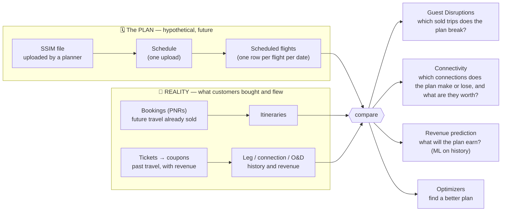
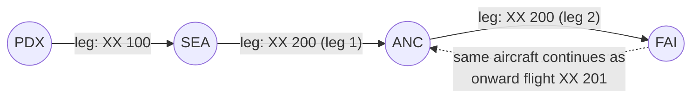
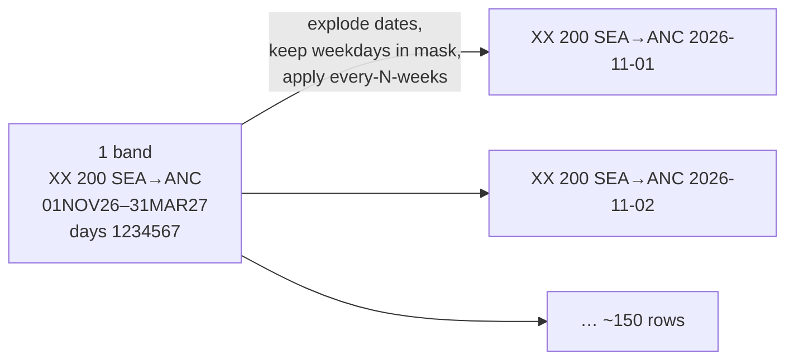
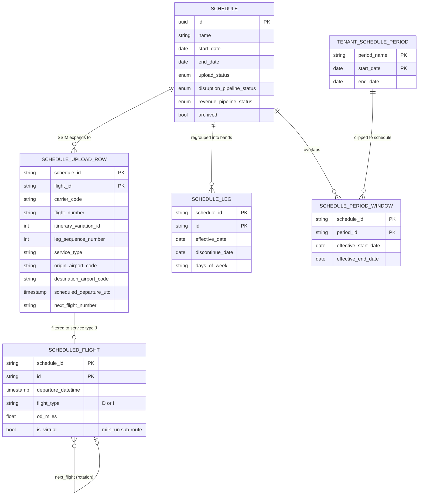
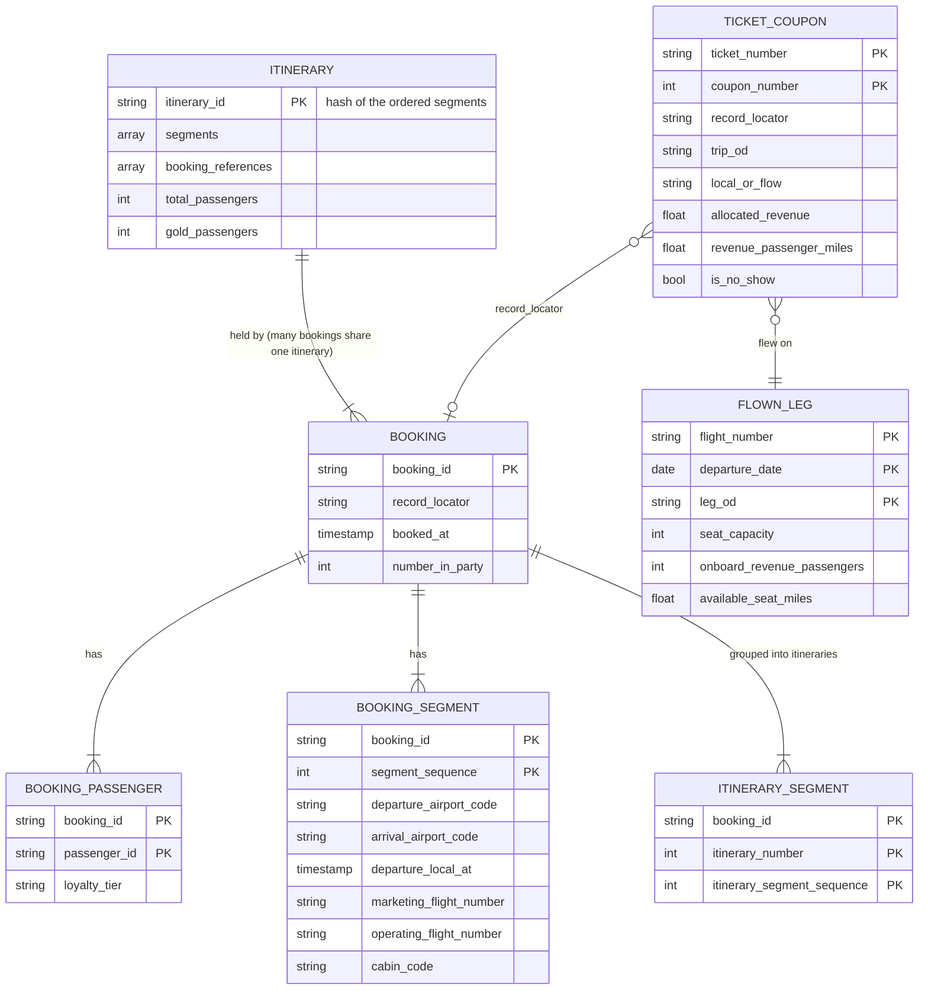
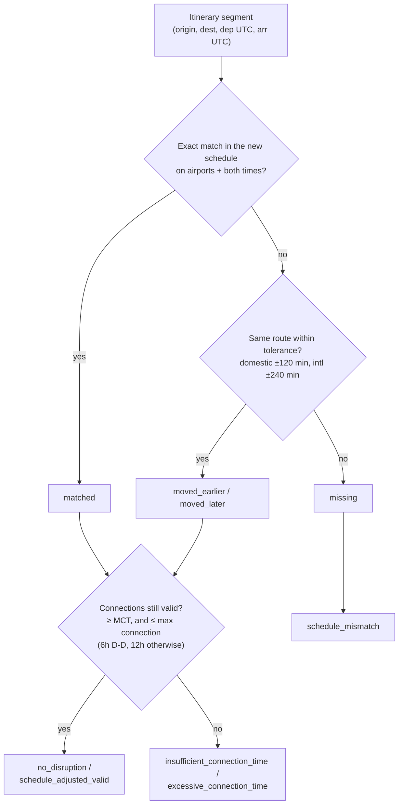

# 02 — The domain data model

*Written 2026-11-03. Confidence markers as in 01: **[code]**, **[docs]**, **[inferred]**.
The cleanest source for every entity below is the data contracts in
`odysee-data-platform/contracts/` — each YAML states its grain, primary key and column meanings in
English. When in doubt, read the contract.*

---

## Layer 0: the one idea

Every table in this system belongs to one of two worlds, and every product is a **comparison**
between them.



If you hold onto this split, most table names decode themselves: anything with `schedule_id` in
its key is the plan; anything keyed by `booking_id`, `ticket_number`, `record_locator`/`pnr` or a
departure date in the past is reality.

---

## Layer 1: the physical world, before any tables

Airline data models are confusing because the *same trip* is described from three viewpoints —
the **aircraft's**, the **passenger's purchase**, and the **passenger's journey** — and each has
its own vocabulary. A synthetic example (made-up flights, not client data):



| Viewpoint | Term | In the example |
|---|---|---|
| **Aircraft** | **Leg** — one takeoff, one landing | PDX→SEA, SEA→ANC, ANC→FAI are three legs |
| | **Flight (number)** — a numbered service; may have several legs | XX 200 is one flight number with two legs. A flight number that stops on the way is a **milk run** |
| | **Rotation** — the chain of flights one aircraft flies | XX 200 then XX 201 (SSIM's *onward flight number*) |
| **Purchase** | **Booking / PNR** — a reservation, identified by a 6-char **record locator** | One PNR for a family of 3 |
| | **Segment** — one flight number between the points the passenger boards and leaves | PDX→SEA on XX 100; SEA→FAI on XX 200 (one segment, two legs!) |
| | **Ticket / coupon** — the financial document; one coupon per flown segment, carrying revenue | 2 coupons per passenger |
| **Journey** | **Itinerary** — the ordered segments of one directional trip | PDX→SEA→FAI |
| | **O&D** (origin & destination) — where the trip *really* starts and ends | PDX–FAI. The code also calls this "true O&D" or "market" |
| | **Connection** — changing aircraft at a station, which must respect **MCT** (minimum connecting time) | at SEA |
| | **Local vs flow** — a passenger whose O&D equals the leg (local) vs one connecting through it (flow) | on SEA→ANC, our family is *flow* traffic |

The thing to internalise: **a leg's revenue is shared among passengers with different O&Ds**,
and **an O&D's revenue is spread across several legs**. Most of the heavy SQL in the warehouse
(prorating, `local_or_flow`, `flow_revenue`, `inbound_flow_percentage`) is bookkeeping between
those two grains. If you've built reporting over a many-to-many order/line-item/shipment model,
it's that problem.

Other vocabulary you'll see on these entities: **cabins** J (business), F (first), W (premium
economy), Y (economy); **gold passengers** = elite loyalty members; **group travelers** = large
party bookings; **OA** = other airline; **AAG** = Alaska Air Group. In code: primary carriers AS (Alaska) and HA
(Hawaiian), regional carriers QX (Horizon) and OO (SkyWest)
(`odysee-data-warehouse/src/utilities/carriers.py:55-65`).

---

## Layer 2: the PLAN side

### 2.1 SSIM: a schedule is a set of *rules*, not a list of flights

An SSIM file is a fixed-width, 200-byte-per-line text format from IATA (yes, punch-card heritage).
Record types:

| Type | Meaning |
|---|---|
| 1 | File header |
| 2 | Carrier record: airline, validity period, whether times are UTC or local |
| **3** | **Flight leg record** — the one that matters |
| 4 | Optional extra data for a leg |
| 5 | Trailer |

Byte layout: `odysee-data-warehouse/src/utilities/ssim.py:43-118` **[code]**. A type-3 record
does **not** describe one flight. It describes a **band**: *this leg, at these times, on these
weekdays, between these dates*. Think of it as a **cron expression for a flight**:

```
3 XX  200 0101J 01NOV2631MAR27 1234567  SEA0800 0800-0800 ANC1045 1045-0900 73H ... onward XX 201
  │   │   │ │ │ └─ effective → discontinue ─┘│       │                │            │
  │   │   │ │ │                              │       dep time + UTC   arr time     aircraft
  │   │   │ │ └ service type J = scheduled passenger      offset
  │   │   │ └ leg sequence 01 (first leg of this flight)
  │   │   └ itinerary variation 01 (distinguishes variants of the same flight number)
  │   └ flight number
  └ airline
                                               └ days of operation: 1=Mon … 7=Sun, space = not operated
```

*(Spacing simplified for readability; real records are exact byte offsets.)*

The pipeline **expands** each band into dated flights — exactly what you'd do to turn a crontab
into a list of run times. The core of it is one Spark `explode(sequence(effective, discontinue))`
followed by a filter on the weekday mask (`ssim.py`, `expand_flights`) **[code]**:



Details the expansion has to get right (each is a comment in the code):
- Times are local + a UTC offset; everything is converted to **UTC** for storage. An arrival
  clock time *earlier* than departure means *next day*.
- `00XXX00` as a date means "until the end of the file's validity period".
- The itinerary variation's hundreds digit lives in a separate overflow byte (byte 127).
- If the same flight is stated twice, the **first** record in the file wins.
- `link_successors` resolves the onward flight number into a pointer to the actual next dated
  flight (`next_flight_id`) — this is the **aircraft rotation**, which the optimizers care about.

### 2.2 The entities on the plan side



| Entity | Grain | Where it lives |
|---|---|---|
| **Schedule** | One upload. Also the *job tracker*: three separate status columns for upload, disruption pipeline and revenue pipeline | App Postgres (RDS), `schedule-service/.../database/models.py:93` **[code]** |
| **Schedule upload row** | One dated flight leg, every service type (incl. cargo, positioning) | `standard.schedule_upload` contract; legacy `bronze_ssim_flight` |
| **Scheduled flight** | One dated *passenger* flight (type J) + **virtual flights**: for a milk run SEA→ANC→FAI, an extra SEA→FAI row so passengers riding through are modelled | `platform.scheduled_flights`; Lakebase `silver_scheduled_flights` |
| **Schedule leg** | Dated flights re-collapsed into bands (what the Leg View page shows) | `platform.schedule_legs`; Lakebase `silver_leg` |
| **Period** | The airline's own planning seasons (e.g. "Winter 26") | `standard.schedule_periods` |
| **Period window** | Period ∩ schedule's date range. Why many API routes are `/{schedule}/{period}/…` | `platform.schedule_period_windows`; Lakebase `gold_disrupted_period` |

Note the round trip: **bands → dated flights → bands**. Bands are how planners think and how
SSIM is written; dated flights are what you can join to a passenger's booking on a specific day.

---

## Layer 3: the REALITY side

Two independent feeds from the airline, which answer different questions:



| Feed | Question it answers | Key entities (standard → platform contracts) |
|---|---|---|
| **Bookings (PNRs)** — current reservations, mostly for *future* travel | "Who is already sold onto flights the new plan might change?" | `standard.bookings`, `booking_segments`, `booking_passengers` → `platform.booking_header`, `itinerary_segments`, **`itineraries`** |
| **Flown revenue (tickets/coupons)** — *past* travel, with money attached | "What is a leg / a connection / an O&D historically worth?" | `standard.flown_revenue`, `flight_legs` → `platform.leg_rasm`, `pax_connectivity`, `connectivity_revenue`, `od_flow_revenue`, `historical_od_daily`, `hist_leg_load_factor_mix` |

One design move worth noticing: **`platform.itineraries` deduplicates across bookings.** Two
hundred PNRs that all fly PDX→SEA→FAI on the same flights on the same day become *one* itinerary
row with `total_passengers = 200+` and a `booking_references` array. That turns "check every
booking against the schedule" into "check every distinct trip shape once" — a big reduction in
work for the disruption job. **[docs + inferred]**

Supporting data on this side:
- **MCT rules** (`standard.minimum_connecting_times`) — not a single number per airport but a
  rule table with ~30 optional condition columns (carrier, terminal, aircraft body, region…);
  null means "any". Resolving the most specific matching rule is its own utility
  (`mct_calculator.py`).
- **Market demand forecast** — expected passengers per route per month (`pdew` = passengers per
  day each way).
- **Reference data** (`platform_<env>.reference`, shared by all tenants): airports + timezones,
  countries/regions, IATA airline codes, aircraft equipment, O&D mileage.

---

## Layer 4: how the products join the two worlds

### Guest Disruptions — the clearest example

Given a new schedule, for every future itinerary (`gold.disrupted_itineraries_v2.py`) **[code]**:



Notice the match key is **airports + times, not flight number**. Renumbering a flight without
retiming it disrupts nobody, which is the right business answer. Disrupted itineraries then go
to an alternatives search (a path-finding job over the new schedule's flights:
`gold_disruption_alternatives`) and get revenue attached.

The API reads the result from Lakebase as `gold_guest_disruptions`,
`gold_disrupted_itineraries`, `gold_disruption_alternatives` and `gold_disrupted_period`
(`schedule-service/.../database/unmanaged/disruption.py`). These tables hold many **JSONB
arrays** (`segments`, `stations`, `booking_references`…). JSONB is Postgres's binary JSON column:
like MySQL's `JSON` type, but indexable with GIN indexes and queryable with operators like
`@>` ("contains"). The tables are denormalised on purpose so one API call is one row read.

### The others, in one line each

| Product | Plan side | Reality side | Output (Lakebase) |
|---|---|---|---|
| **Connectivity Intelligence** | Every feasible two-leg connection in the new schedule (respecting MCT) | Historical passengers and revenue per connection and O&D; demand forecast | `gold_connectivity_true_od`, `_opportunities` (e.g. "retime this flight N minutes to create a connection worth $X"), `_opportunity_impacts`, `connectivity_od_served_flights` |
| **Revenue prediction** | Scheduled flights + features (time of day, bank, connectivity) | `leg_rasm` history → ML model (odysee-mlops / odysee-ds) | `gold_schedule_revenue`, `predicted_revenue`/`flow_revenue` fields on flights |
| **Attribution** | A "fix" schedule vs the schedule that caused a disruption | Bookings that later flew, or cancelled | `gold_preserved_itineraries`, `gold_incremental_attribution`: "this schedule fix saved $X of booked revenue" |
| **Optimizers** | A base schedule + constraints → altered schedule options | Revenue and demand inputs | `{catalog}.ai.schedule_optimizer_*`, `ai.fleet_gauge_*` |

---

## Layer 5: one concept, many names

The same entity appears under different names in each layer and repo. This table is the
decoder ring:

| Concept | App Postgres (RDS) | Legacy warehouse (`alaska_sierra_<env>_catalog`) | New contract (`<tenant>_<env>`) | Lakebase (API reads) |
|---|---|---|---|---|
| A schedule upload | `schedule` | — | — (`schedule_id` key everywhere) | — |
| Dated flight in a schedule | `flight` (ORM model still defined, but unused by any service code: vestigial) | `silver.silver_schedule_flights_v2` | `standard.schedule_upload` → `platform.scheduled_flights` | `silver_scheduled_flights` |
| Band | — | `silver.silver_leg` | `platform.schedule_legs` | `silver_leg` |
| Period | — | `gold.schedule_periods_v2` | `standard.schedule_periods`, `platform.schedule_period_windows` | `gold_disrupted_period` |
| Distinct booked trip | — | `silver.silver_itineraries` | `platform.itineraries` | inside `gold_disrupted_itineraries` |
| Flown leg + revenue | — | `gold.fact_leg_rasm` | `platform.leg_rasm` | — |
| Passenger connection | — | `silver.pax_connectivity` | `platform.pax_connectivity` | — |
| Origin is called… | `departure_airport` | `departure_airport`, `leg_orig`, `orig`, `origin` | `origin_airport_code` (standard), varies in platform | `origin`, `itinerary_origin` |

The new contracts keep the warehouse's *column names* in several `platform` tables on purpose
(`leg_rasm` still has `leg_dptr_dt`, `leg_flt_nbr`) so existing readers don't break during the
migration. Expect that inconsistency to stay for a while.

---

## Gotchas and honest observations

- **Flight IDs are not stable in the legacy pipeline.** `expand_flights` assigns `uuid()`
  (`odysee-data-warehouse/src/utilities/ssim.py`), so reprocessing a schedule yields new flight
  IDs. The new `standard.schedule_upload` contract explicitly requires an ID that is "the same on
  every republish" (a hash of schedule_id + flight identity). Anything that stores a flight ID
  across reprocessing in the legacy world is fragile. **[code + docs]**
- **UTC vs local.** Storage is UTC; *business dates* are local ("departure date" = local date at
  origin). Many columns exist in both forms (`scheduled_departure_utc` / `_local`). Filtering on
  the wrong one shifts flights across midnight — the disruption job explicitly converts to local
  date for its window filter.
- **Weekday numbering**: SSIM and this code use 1 = Monday … 7 = Sunday, not Spark's
  `dayofweek()` (1 = Sunday). `monday_based_weekday` exists for this reason.
- **A misleading comment**: `gold.disrupted_itineraries_v2.py` says the zero-revenue filter is
  "off by default", but `FILTER_ZERO_REVENUE = True`. Itineraries with zero booked revenue
  (e.g. award tickets?) are excluded from disruption analysis. Worth asking whether that's
  intended. **[code]**
- **Carrier group logic is hard-coded for Alaska** in the legacy warehouse
  (`src/utilities/carriers.py`: `PRIMARY_CARRIERS`, `GROUP_CARRIERS`, `SOURCE_CARRIERS`). The
  new world replaces this with `standard.carrier_profile`. The disruption job also has a special
  path for "OA showcase" schedules (a demo of another airline's schedule against Alaska's
  bookings).
- **Several contracts are still `draft` with no columns** (`itinerary_schedule_match`,
  `connectivity_core`, `schedule_revenue`, `competitive_schedule`), i.e. the shared *product*
  layer is not yet designed for disruption matching or revenue prediction. That logic lives only
  in the legacy warehouse today.

---

## What to look at next

- Open one contract YAML end to end, e.g. `odysee-data-platform/contracts/platform/scheduled_flights.yaml`;
  the column descriptions are the best domain documentation in the company.
- Read `match_segments_to_schedule` and `analyze_time_shifts` in
  `odysee-data-warehouse/src/pipelines/gold/gold.disrupted_itineraries_v2.py:149-387`.
- Then deep dive #2 from the overview (one product top to bottom) will make much more sense.
