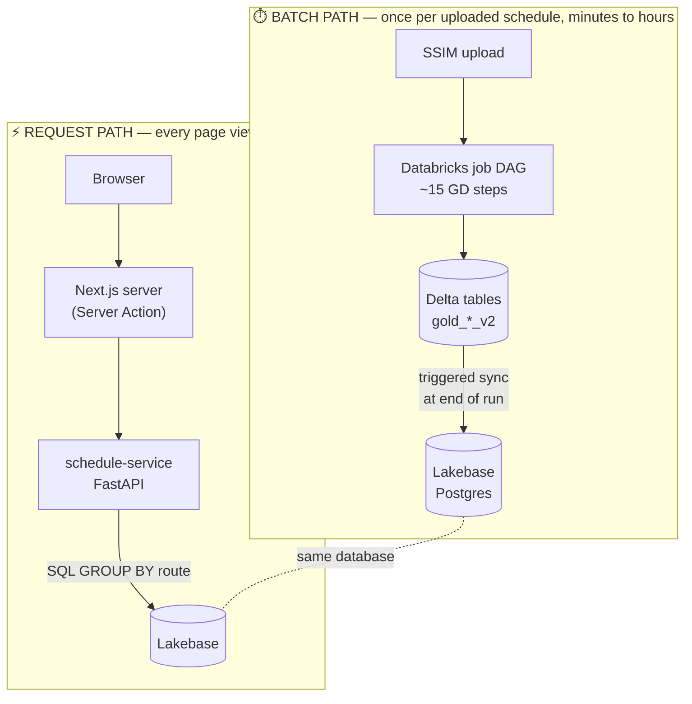
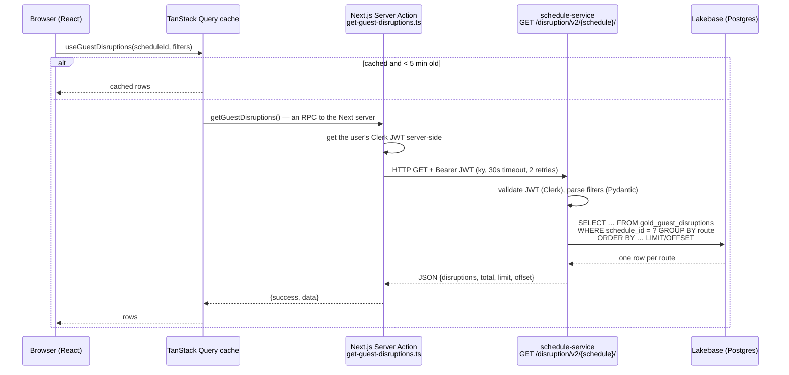
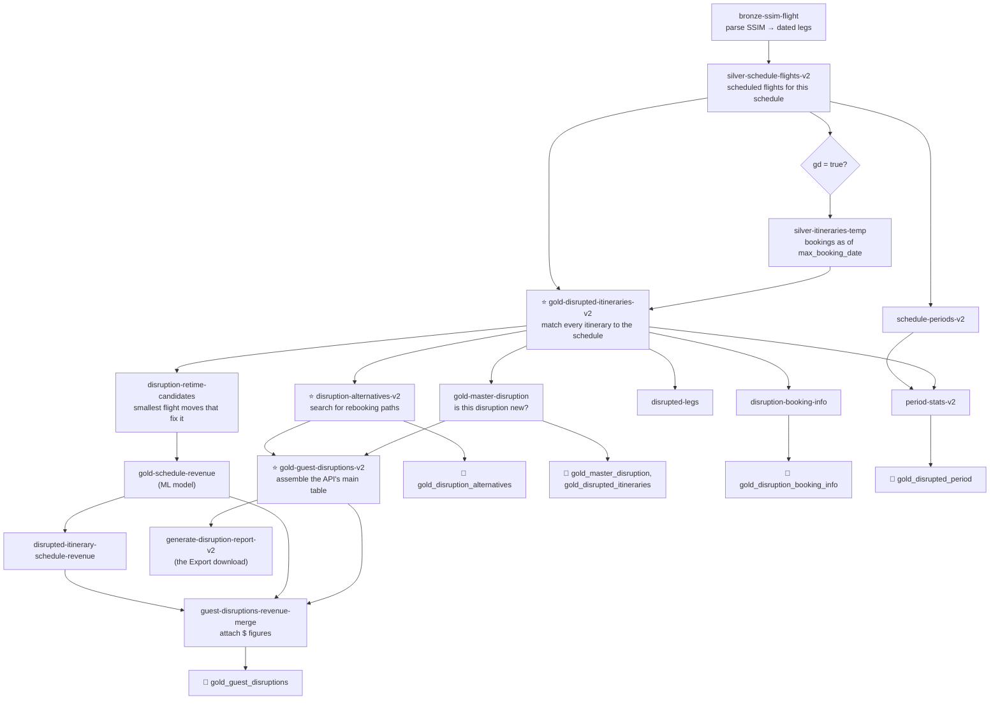
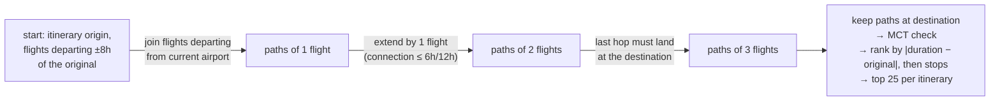

# 03 — Guest Disruptions, top to bottom

*Written 2026-11-03. Confidence markers: **[code]**, **[docs]**, **[inferred]**. Builds on
[02-domain-data-model.md](02-domain-data-model.md): read its "plan vs reality" section first.*

**The question this product answers:** *"If we fly this new schedule, which passengers who have
already bought tickets will find their trip broken, how badly, can we rebook them, and what is
it worth?"*

---

## Layer 0: the whole thing on one page

There are two completely separate paths, and they never run at the same time:



All of the intelligence lives in the batch path. The request path is a thin, read-only
reporting layer over pre-computed tables. If you've built a reporting UI over nightly ETL
output, this is the same architecture, with "nightly" replaced by "per upload".

---

## Layer 1: what the user sees

`odysee-frontend/apps/web/src/app/(main)/connections/guest-disruptions/page.tsx` **[code]**

```
┌ Guest Disruptions ────────────────────────────── [Export] [Filters] ┐
│ Route          │ Disruption events   │ Guests │ Booked $ │ Δ Rev │ Alt paths/day │
│ PDX-SEA-FAI  ▸ │ 1 not found · 2 moved│   214  │  $61k    │ -$4k  │     3.5       │
│   ├ tab: Schedule Changes     → which flight changed, old vs new times      │
│   ├ tab: Impacted Dates       → chart + table of affected departure dates   │
│   └ tab: Alternative Pathways → rebooking options per date                  │
└──────────────────────────────────────────────────────────────────────────────┘
```

- **One table row = one route** (e.g. `PDX-SEA-FAI`), summed over every date and every
  itinerary that shares it. This is the single most important fact for reading the API code.
- The page is gated by a feature flag (`guestDisruptionsFlag`). Revenue columns have flags of
  their own (`revenueDataFlag`, `predictedRevenueFlag`), so not every customer sees money.
- Filters: schedule period, disruption type (`not-found`, `changed`,
  `min-connection-time`, `max-connection-time`), pathway availability (0 / 1–4 / 5+),
  stations, guest counts, "new disruptions only", local vs UTC time
  (`config/filters/guest-disruptions.filters.ts`).
- "Which schedule?" comes from app-wide React context (`useCurrentSchedule()`), not the URL.

---

## Layer 2: the request path



| Hop | File | What it does |
|---|---|---|
| Hook | `apps/web/src/hooks/guest-disruptions/use-guest-disruptions.ts` | TanStack Query: caches per (schedule, filters) for 5 min, keeps the previous page visible while a new filter loads |
| Server Action | `apps/web/src/app/actions/guest-disruptions/get-guest-disruptions.ts` | `"use server"`: runs on the Next server, not in the browser |
| HTTP client | `apps/web/src/lib/api-client.ts` | `ky` with the Clerk token, base URL `NEXT_PUBLIC_API_URL` |
| Route | `schedule-service/schedule_service/api/disruption.py` | 7 routes under `/disruption` |
| Service | `schedule-service/schedule_service/services/disruption.py:71` | Builds the SQL with SQLAlchemy |
| Table model | `schedule-service/schedule_service/database/unmanaged/disruption.py` | "Unmanaged" = the API reads these tables but doesn't own them; Alembic never migrates them |

**Why a Server Action in the middle?** The browser never talks to schedule-service directly.
The Next server acts as a *backend-for-frontend*: the auth token is fetched and attached
server-side. From a Perl/JS background, a Server Action is effectively an auto-generated JSON-RPC
endpoint. You write an async function marked `"use server"`, call it like a local function from
client code, and Next turns that call into a POST to itself.

### The SQL, in plain terms

`get_disrupted_routes` produces roughly this (simplified):

```sql
SELECT route,
       min(itinerary_id)                       AS itinerary_id,    -- an arbitrary representative
       sum(total_cabin_W+F+J+Y)                AS passenger_impact,
       sum(total_cabin_W+F+J)                  AS gold_passengers, -- ⚠ premium cabins, see findings
       sum(group_travelers), sum(booked_revenue), sum(ml_total_rev), sum(schedule_revenue),
       count(DISTINCT local_departure_date)    AS impacted_days_count,
       count(DISTINCT CASE WHEN lower(disruption_reason) LIKE '%not found%' THEN disruption_reason END) AS not_found_count,
       count(DISTINCT CASE WHEN lower(disruption_reason) LIKE '%moved%'     THEN disruption_reason END) AS moved_count,
       bool_or(is_new_disruption)              AS has_new_disruption,
       count(*) OVER ()                        AS total_count      -- total for pagination, same query
FROM   gold_guest_disruptions
WHERE  schedule_id = :id AND NOT invalid_itinerary AND <filters>
GROUP  BY route
HAVING <guest-count / connectivity filters>
ORDER  BY passenger_impact DESC LIMIT 25 OFFSET 0;
```

The Postgres-specific features, since you know MySQL:

| Feature | What it is | MySQL equivalent |
|---|---|---|
| `jsonb` columns | Binary JSON. `segments`, `stations`, `connecting_stations` are arrays stored in a column | `JSON` type |
| `connecting_stations @> '["SEA"]'` (SQLAlchemy `.contains`) | "array contains", can use a GIN index | `JSON_CONTAINS()`, which can't use an ordinary index |
| `jsonb_array_length(x)` | element count, used for "number of stops" and "has MCT violations" | `JSON_LENGTH()` |
| `bool_or(x)` | aggregate OR across the group | `MAX(x)` on a 0/1 column |
| `count(*) OVER ()` | window function: total row count before LIMIT | `SQL_CALC_FOUND_ROWS` (deprecated) or a second query |

The other six routes follow the same pattern for the expanded row: `/{route}/changes/`,
`/{route}/dates/` and `/{route}/alternatives/` re-query the same tables filtered to one route,
and `filter-options/` and `booking-info/` feed the filter UI and the "bookings as of" banner.

---

## Layer 3: the batch path, as a DAG

After the upload, schedule-service calls Databricks `run-now` on **`bronze_ssim_flight_job`**
(see [01](01-system-overview.md)). That job parses the SSIM, then runs
**`silver_schedule_flights_v2_job`**, the master DAG for everything per-schedule
(`odysee-data-warehouse/resources/schedule_flights_v2_job.tf`, ~1300 lines, 40+ tasks). Two
parameters, `ci` and `gd`, come from `Schedule.enabled_features` and switch the Connectivity
Intelligence and Guest Disruptions branches on or off with Databricks `condition_task`s
(an if-node in the DAG).

The Guest Disruptions branch, simplified (each box is a sub-job or notebook; 🔄 = sync to
Lakebase):



**Lakebase sync is triggered, not continuous.** Each 🔄 is a task that kicks the
`databricks_database_synced_database_table` pipeline for one table, with
`scheduling_policy = "TRIGGERED"` (`resources/gold_guest_disruptions_v2_sync.tf`). The Postgres
copy is only refreshed at the end of a run. The Lakebase primary key for the main table is
`(schedule_id, itinerary_id)`. **[code]**

**How the UI learns it's done.** schedule-service stores the Databricks `run_id` in
`schedule.disruption_pipeline_job_id`, and a background loop
(`services/upload_status.py:99`, `process_incomplete_schedules`) polls it. On success it sets
`upload_status = FINISHED` and sends the uploader a notification (Novu). Failure becomes
`ERROR`. **[code]**

---

## Layer 4: the algorithm, stage by stage

### Stage 1 — Which itineraries? (`silver.silver_itineraries_temp`, start of `gold.disrupted_itineraries_v2`)

- Source: distinct itineraries built from current bookings. When `max_booking_date` is set, the
  `_temp` variant only uses bookings made up to that date, which lets you replay "what did we
  know on date X".
- Only itineraries whose **every** segment departs (by local date) inside the schedule's window.
- **Zero-revenue itineraries are dropped** (`FILTER_ZERO_REVENUE = True`; see findings).

### Stage 2 — Match each segment to the new schedule (`match_segments_to_schedule`, `analyze_time_shifts`)

Covered in detail in [02, Layer 4](02-domain-data-model.md#layer-4-how-the-products-join-the-two-worlds).
The essentials: match on **(origin, destination, departure UTC, arrival UTC)**. If that fails,
look for the closest same-route flight within ±120 min (domestic) or ±240 min (international).
Each segment gets a **severity**:

| Segment outcome | `segment_severity_minutes` |
|---|---|
| exact match | `0` |
| shifted within tolerance | max(\|departure shift\|, \|arrival shift\|) in minutes |
| not found / replaced | `9999` (sentinel) |

**Itinerary severity = the max over its segments** (`gold.disrupted_itineraries_v2.py:582-592, 898`). **[code]**

### Stage 3 — Do connections still work? (`apply_mct_validation`, `validate_maxct_connections`)

A shift too small to be a disruption by itself can still break a connection. Shifted itineraries
are re-checked against the **MCT rule table** (resolved per airport, carrier, terminal…; see 02)
and a **maximum connection** (6 h domestic→domestic, 12 h otherwise). Violations are stored as
JSONB arrays (`mct_violations`, `max_connection_time_violations`), which is how the API's
"disruption type" filter tells MCT, max-CT and plain-moved cases apart
(`services/disruption.py:300`).

### Stage 4 — Is it new? (`gold.master_disruption`)

Each disrupted itinerary gets a `disruption_signature` (built from its specific failures). The
job anti-joins `(itinerary_id, signature)` against a **cross-schedule history table** and flags
pairs never seen before with `is_new_disruption`. Planners iterate on many uploads; this lets the
UI show "new disruptions only", meaning ones this version introduced. **[code]**

### Stage 5 — Find rebooking alternatives (`src/jobs/disruption_alternatives_v2.py`)

A **breadth-first path search over the new schedule's flights**, written as repeated Spark
joins rather than a graph library:



| Rule | Value | Source line |
|---|---|---|
| Max flights in a path | 3 (`MAX_STOPS`; the loop runs 3 times) | `:79, :358` |
| First departure | within ±8 h of the original departure | `:88` |
| Max trip lengthening | original duration + 8 h | `:87, :351` |
| Connection window | 6 h D→D, 12 h otherwise | `:80` |
| Carriers | own group only, unless the original itinerary already used another airline | `:305` |
| Kept per itinerary | 25 | `:78, :530` |

**A Spark trick worth understanding:** Spark is bad at *range* joins ("flights departing between
time A and time B"). The code turns a range into equality: every partial path is `explode`d into
the list of **hour buckets** it could connect in, flights are pre-bucketed by departure hour
(`flights_by_hour`), and the join is on `(airport, hour)`, followed by an exact-time filter. It's
the same idea as indexing a MySQL table on `FLOOR(ts/3600)` to turn a range scan into lookups.
Each iteration's result is written out (`staging.materialise`) so the query plan doesn't grow
with every loop pass.

Note what it does **not** check: seat availability. An alternative is "a valid path through the
schedule", not "a path with free seats". **[inferred from the filters present; worth confirming]**

### Stage 6 — Assemble the API table (`gold.guest_disruptions_v2.py`)

Keep only `disrupted = true` itineraries, join the count of alternatives and the best one
(shortest duration), and generate the human-readable reason:

```
severity < 1440  →  "Flight moved {severity} minutes"
otherwise        →  "Flight not found in schedule"
```

### Stage 7 — Attach money (`gold.guest_disruptions_revenue_merge.py`)

Three revenue numbers per itinerary, easy to confuse:

| Column (DB → UI) | Meaning |
|---|---|
| `booked_revenue` → **Booked $** | What these passengers actually paid (from bookings) |
| `schedule_revenue` | ML-predicted revenue of the itinerary **under the uploaded schedule as-is** |
| `ml_total_rev` → **Predicted $** | ML-predicted revenue **if the disruption were fixed** with the smallest set of flight moves (`disruption-retime-candidates`). If no move fixes it, falls back to the as-is value |

In the API (`models/disruption.py:99`): **Δ Rev = schedule_revenue − ml_total_rev**, summed
over the route and excluding not-found itineraries (severity 9999), which have no prediction.
A negative number is roughly "the revenue this disruption costs you, compared with fixing it".
It also attaches `historical_pax_data`: each segment's historical load factor and passenger mix
for context.

---

## Layer 5: how the grain changes on the way up

| Stage | One row = | Table |
|---|---|---|
| Matching | one segment of one itinerary | (in-memory, exploded) |
| Disrupted itineraries | one itinerary × schedule (dated: the itinerary has specific flights on specific days) | `gold_disrupted_itineraries_v2` |
| Alternatives | one rebooking path for one itinerary | `gold_disruption_alternatives_v2` |
| Guest disruptions | one *disrupted* itinerary × schedule | `gold_guest_disruptions_v2` → Lakebase `gold_guest_disruptions` |
| API / UI table | **one route**, aggregated over all dates and itineraries | computed per request |
| Period summary | one schedule period | `gold_disrupted_period` |

---

## Findings: things that look wrong or surprising

1. **"N moved" counts distinct shift *sizes*, not flights or passengers.** The API counts
   `DISTINCT disruption_reason`, and the reason text embeds the minutes ("Flight moved 30
   minutes"). A route with 50 itineraries all moved by 30 minutes shows "1 moved"; one with two
   itineraries moved by 30 and 35 shows "2 moved". **"Not found" can only ever be 0 or 1**,
   because that text is a constant. The frontend's mock data agrees: `notFoundCount` is always 0
   or 1. Possibly intentional ("distinct events"), but the label invites the wrong reading.
   **[code: `services/disruption.py` + `gold.guest_disruptions_v2.py`]**
2. **"gold_passengers" means two different things.** In the data contracts it means elite
   loyalty members. In the API's aggregate, `GOLD_PAX = W + F + J` cabins, i.e. **premium
   cabin** passengers, which the UI shows as "premium %". The table's actual `gold_passengers`
   (loyalty) column is ignored on this page. Not wrong for the UI, but a trap for anyone joining
   the two.
3. **Two thresholds for "not found".** The pipeline uses `9999` as the sentinel; the reason text
   uses `severity < 1440`; the API filters on `== 9999`. They agree today only because no real
   shift can exceed the ±240-min tolerance. Fragile coupling across two repos.
4. **The table row's `itinerary_id` is `min(itinerary_id)`**, an arbitrary representative of the
   route. The expanded tabs query by route, so this mostly doesn't matter, but anything keyed on
   that ID shows one itinerary out of many.
5. **Zero-revenue itineraries are excluded** (`FILTER_ZERO_REVENUE = True`, with a comment
   saying "off by default"). Already in open questions (#8).
6. **Hard-coded Alaska fleet in the alternatives job**: `AIRCRAFT_BODY_TYPES` lists specific
   equipment codes, and carrier logic uses `GROUP_CARRIERS`. This is the kind of thing the
   data-platform migration (see 01) is meant to remove.
7. **No seat-availability check on alternatives** (inferred, see Stage 5).

---

## Good next steps

- **Read in this order:** `gold.guest_disruptions_v2.py` (192 lines, short and readable) →
  `services/disruption.py:71-200` (the SQL) → `disruption_alternatives_v2.py:255-430` (the
  search) → `gold.disrupted_itineraries_v2.py` (1500 lines, the heart; skim the function list
  first).
- **Run it locally without Databricks:** the frontend has MSW mocks
  (`apps/web/src/mocks/data/guest-disruptions.ts`), but they are **off by default**. Set
  `guestDisruptions: true` in `apps/web/src/mocks/config.ts` (and probably `auth: true` to skip
  Clerk) before `pnpm dev`. I haven't tried this yet.
- **Ask a human:** findings 1–3 and 7 (added to open questions).
