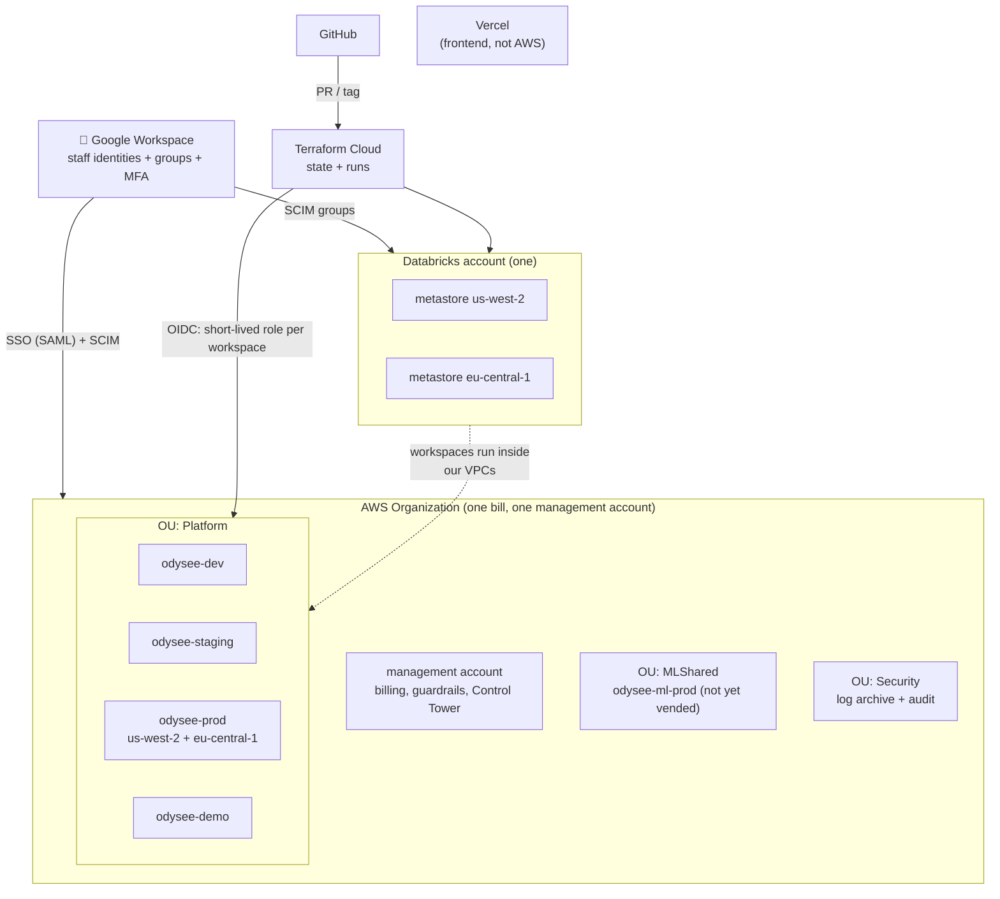
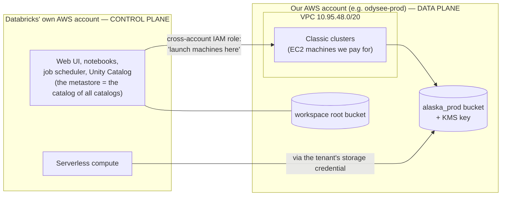
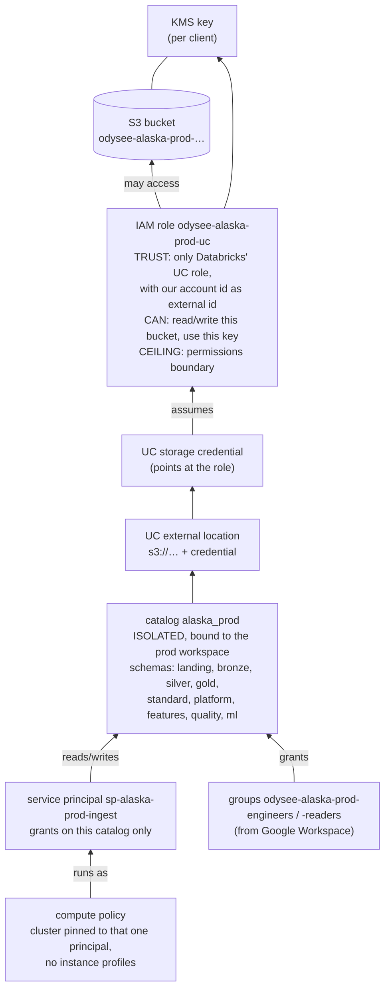
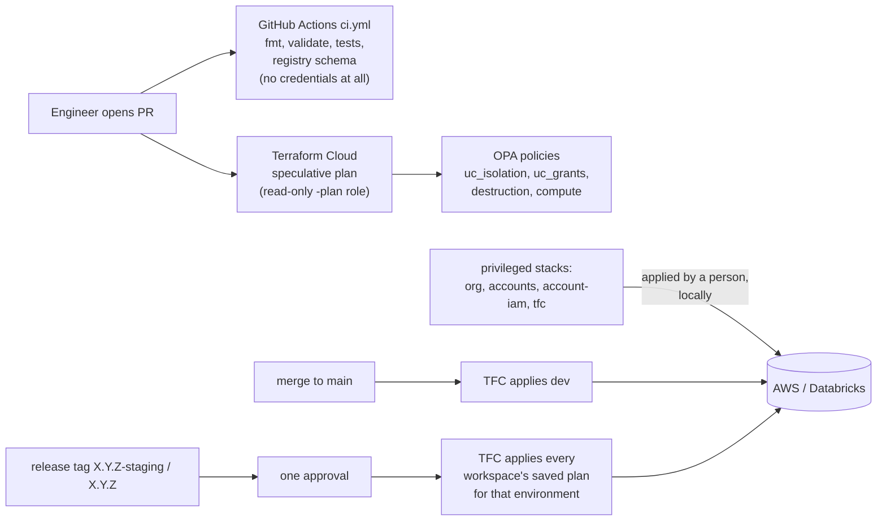

# 04 — AWS and Databricks infrastructure, from first principles

*Written 2026-11-03 from `odysee-infra` (35 ADRs, 14 stacks, 11 modules) and
`schedule-service/infra`. Confidence markers: **[code]**, **[docs]**, **[inferred]**. Assumes
no AWS background; every AWS term is explained by analogy the first time it appears.
`adr/NNNNN` always means `odysee-infra/adr/NNNNN.md`.*

---

## Layer 0: the whole estate on one page

Three outside systems define everything: **Google Workspace** says who people are,
**Terraform Cloud** is the only thing allowed to change infrastructure, and the **Databricks
account** spans all the AWS accounts. The frontend isn't in AWS at all; it's on Vercel.

---

## Layer 1: AWS vocabulary, mapped to things you already know

Read this table once; the rest of the doc assumes it.

| AWS concept | What it is | Analogy |
|---|---|---|
| **Account** | A fully separate container for resources, permissions and billing. Nothing crosses between accounts unless both sides explicitly allow it | A separate physical datacenter with its own root password. The hardest wall AWS has |
| **Organization** | A tree of accounts under one management account, with one bill | The company owning several datacenters |
| **OU** (organizational unit) | A folder in that tree; policies attached to it apply to every account inside | An LDAP OU with a group policy |
| **SCP / Control Tower** | Guardrails on an OU that **even an account's root user cannot override** ("no one may disable audit logging") | `chattr +i` on the rules themselves |
| **Region / AZ** | A geographic area (`us-west-2` = Oregon, `eu-central-1` = Frankfurt) / an independent datacenter within it | Colo sites / buildings on a campus |
| **VPC** | Your private network inside a region, with your own IP range (`10.95.x.x`) | The office LAN |
| **Subnet** (private / public) | A slice of the VPC. *Private* = no inbound from the internet | VLANs: DMZ vs internal |
| **NAT gateway + Elastic IP** | Lets private machines reach out to the internet from a **fixed public IP** | A home router doing NAT with a static IP |
| **VPC endpoint** | A private path to an AWS service (S3, STS) that never touches the internet | A direct cable to the storage room |
| **Security group** | A stateful firewall attached to a machine/interface | `iptables` rules per host |
| **IAM role** | A *hat* that a person or service can put on to get permissions, for a limited time (typically an hour) | `sudo -u someuser`, with an expiring ticket |
| **Trust policy** (on a role) | **Who may put on the hat** | `/etc/sudoers` |
| **Permission policy** | **What the hat lets you do** | Unix file permissions + DB GRANTs |
| **Permissions boundary** | A ceiling: the role can never do more than this, whatever its policies say | `ulimit` for privileges |
| **Assume role / STS** | Trading your identity for temporary credentials of a role | Kerberos ticket exchange |
| **OIDC federation** | A non-AWS system (Terraform Cloud, GitHub) proves who it is with a signed token and gets a role, **with no stored password** | SSH certificate auth instead of a password file |
| **IAM Identity Center** | AWS's single sign-on, federated to Google Workspace | "Log in with Google" for the AWS console and CLI (`aws sso login`) |
| **S3** | Object storage: bucket → key → blob, effectively infinite | A huge key-value filesystem; no rename, no append |
| **KMS** | Managed encryption keys. Data is encrypted with keys that never leave the service; using the key is itself an IAM permission | An HSM you call over an API |
| **ECS Fargate / ECR** | Run Docker containers without managing servers / a private Docker registry | `docker run` as a service / a private Docker Hub |
| **RDS / ElastiCache (Valkey)** | Managed Postgres/MySQL / managed Redis | The DB and cache servers you used to babysit |

The single idea that unlocks most AWS designs: **permissions = (who may assume a role) ×
(what that role may do)**, and almost nothing uses long-lived passwords or keys. Things *prove
who they are* and receive short-lived credentials.

---

## Layer 2: how Databricks sits on AWS

Databricks is split in two, and the split decides where security boundaries can go:

- **Account → workspaces.** One Databricks account; one *workspace* per environment (dev,
  staging, prod-us, prod-eu, demo). A workspace is the UI/notebook/jobs environment people use.
- **Metastore** (Unity Catalog). The catalog of every catalog. **Databricks allows only one per
  region per account** (`adr/00001`), so dev, staging and
  prod in `us-west-2` all hang off **the same metastore**. Remember this; it's why the next
  layer is needed.
- **Cross-account role.** An IAM role in our account whose trust policy says "Databricks may
  assume this". That's how Databricks launches machines in our VPC
  (`modules/databricks-workspace/iam.tf`).
- **Lakebase** (the Postgres the API reads) and serverless jobs run in Databricks'
  infrastructure, not our VPC. **[inferred from how Databricks works; not in this repo]**

---

## Layer 3: Odysee's layout

### Accounts and regions

| Account | OU | Region(s) | Holds | Status |
|---|---|---|---|---|
| management | root | — | Billing, Control Tower, the org trail. **Also an old Databricks workspace** that predates the repo | Being replaced (`adr/00013`) |
| `odysee-dev` | Platform/Dev | us-west-2 | Dev workspace. Per `stacks/tfc`: "no client data of any kind" | Live |
| `odysee-staging` | Platform/Staging | us-west-2 | Staging workspace; real client data **with identifiers masked** (`adr/00010`), so it carries prod's controls | Live |
| `odysee-prod` | Platform/Prod | us-west-2 **and** eu-central-1 | Production; the EU workspace exists for clients needing EU data residency | Live |
| `odysee-demo` | Platform/Demo | us-west-2 | Sales demos, **synthetic data only**, written as a prohibition (`adr/00020`) | Live |
| `odysee-ml-prod` | MLShared | eu-central-1 per `adr/00022` (pending CTO/legal; `adr/00016` still lists us-west-2) | Cross-client model training, only from tables a client contractually allows | Not vended |

Regions are asymmetric on purpose (`adr/00012`): **us-west-2
is "home"** (dev, staging, prod); a client region gets **prod only** and is created only
against a signed client requirement.

### Clients (tenants)

From `odysee-infra/registry/tenants.yaml` **[code]**:

| Key | Who | Region | Environments |
|---|---|---|---|
| `alaska` | Alaska Airlines | us-west-2 | dev, staging, prod |
| `ba` | British Airways | eu-central-1 | prod only (the whole EU region) |
| `odyseeairway` | Synthetic test airline | us-west-2 | dev, staging; deliberately the *second* us-west-2 tenant so isolation tests have a same-region pair |

**Adding a client = adding an entry to that YAML** and opening a PR. If onboarding needs new
Terraform, the module has a bug (`adr/00004`).

### Network

Each environment gets a `/20` inside `10.95.0.0/16` (`adr/00016`),
split into private `/22`s per availability zone (where clusters run) plus small public subnets
(for NAT). Prod uses 3 AZs, everything else 2. Ranges are planned so they never overlap,
because Alaska's network team routes some of them.

Outbound traffic leaves through NAT gateways with **pre-allocated Elastic IPs**
(`stacks/egress-addresses`). Odysee reads Alaska's data from Alaska's systems, and Alaska's
firewall team needs 1–2 weeks plus a security review to allow-list a new source IP, so the IPs
were allocated *before* the networks existed to get that lead time off the critical path. **[docs]**

---

## Layer 4: the two walls — environment and client

**The AWS account is the environment wall. The Unity Catalog catalog is the client wall.**
(`adr/00004`, `adr/00005`)

Since every us-west-2 environment shares one metastore, the environment wall needs a second
layer inside Databricks: every catalog is set to **`ISOLATED`** and **bound** to the workspaces
allowed to use it. The default (`OPEN`) would make `alaska_prod` visible from the dev
workspace. With binding, a person holding a grant on `alaska_prod` still can't reach it from dev.

### What one client in one environment consists of

Here is the chain for `alaska` in `prod`, from bytes on disk up to a job that reads them. Every
link is a separate object, and every one is per-client:

Code: `modules/tenant-storage` (bucket, KMS), `stacks/tenants/iam.tf` (role),
`modules/tenant-uc` (credential, location, catalog, schemas, volumes, grants, bindings),
`modules/tenant-identity` (principals, groups), `modules/compute-policy`. **[code]**

**Why pinned compute matters** (`adr/00006`): a pipeline
for Alaska runs on a cluster that can only *be* `sp-alaska-prod-ingest`, so even buggy or
malicious code that asks for BA's table gets "permission denied". The defence doesn't rely on
the code being correct. MySQL analogy: every client gets its own DB user, and the connection
pool for client A is hard-wired to user A's credentials.

**How client data arrives.** Alaska *pushes nothing*. Alaska publishes a **Delta Share** from
**its own** Databricks metastore (on Azure, `westus2`), and Odysee mounts it read-only as the
catalog `alaska_share` (`tenants.yaml`, `adr/00025`). Every
read crosses clouds. That's why the egress IPs matter, and why the data-platform's Alaska
adapter starts from `alaska_share`.

---

## Layer 5: how infrastructure changes

- **Terraform** is a declarative language: you describe the desired state and it computes the
  diff (`plan`) and executes it (`apply`). Think of it as a schema-migration tool where the
  "schema" is your entire cloud. **State** is its record of what it created; it lives in
  Terraform Cloud.
- **No static cloud keys in CI.** Each Terraform Cloud workspace proves its identity with an OIDC
  token and assumes a role scoped to *that one workspace*
  (`stacks/account-iam`, `modules/tfc-oidc`). GitHub Actions never runs `apply`
  (`adr/00027`).
- **Terraform Cloud projects are the privilege boundary** (`stacks/tfc`): `odysee-foundation`
  (management account, metastores), `odysee-dev`, `odysee-staging`, `odysee-prod`… A team grant
  attaches to a project.
- **A console click is an incident.** Everything is Terraform, partly for SOC 2 change-management
  evidence. You'll see that motivation all over the ADRs.
- **Stacks vs modules.** A *stack* is something you `apply` (one state file). A *module* is a
  reusable function stacks call. Rough order of application **[inferred from dependencies]**: `tfc` → `org` → `accounts` →
  `account-iam` → `foundation` (metastores) → `environment` (VPC + workspace) →
  `workspace-config` → `tenants` → `platform-catalog`.

### The apps live elsewhere

| Thing | Where it runs | Its Terraform |
|---|---|---|
| schedule-service | ECS Fargate in `odysee-dev` / `-staging` / `-prod` / `-demo`, behind a load balancer, with RDS Postgres and Valkey | `schedule-service/infra/` (its own repo, applied **from GitHub Actions**, a recorded deviation) |
| Data pipelines | Databricks jobs | `odysee-data-warehouse/resources`, `odysee-data-platform/resources`, `odysee-optimizers/databricks.yml` (`adr/00019`: infra and pipeline Terraform live in separate repos) |
| Frontend | Vercel | none here |

---

## Honest observations

1. **The infra README's status block is stale.** It says the repo "has created no Databricks
   workspace" and that the isolation suite is "specified and not yet written". But
   `stacks/environment` has tfvars for dev, staging, prod, euc1-prod and demo (dev added
   2026-10-01, the README last touched the same day), and `tests/isolation/` holds ~8,000
   lines of Python plus an `isolation-nightly.yml` workflow. This largely answers open question
   #1: the workspaces the warehouse deploys to were most likely created by `stacks/environment`.
   **[code; the timing link is inferred]**
2. **Documentation style: careful, but heavy.** READMEs and ADRs carry long, dated,
   self-correcting notes ("this said X until 2026-09-03…"). The rationale is excellent. The
   current state is often buried under history, so read the *code* (tfvars, `locals.tf`) for
   "what is true now".
3. **IP range collision.** schedule-service's `temporary-network` VPC (in `odysee-dev`) uses
   `10.95.96.0/20`, the same range odysee-infra later gave the demo VPC. They're in different
   accounts and demo isn't routed by Alaska, so nothing breaks today, but it's exactly what
   adr/00016 exists to prevent. The temporary network is meant to be deleted once the real dev
   VPC exists, which it now appears to.
4. **Dev's schedule-service security group allows one specific public `/32`.** Probably a
   developer's IP; worth knowing it's there.
5. **Expiring soon:** `stacks/migration-export` (the Azure→AWS data export, with the repo's only
   long-lived static AWS key) is set to expire **2026-11-18**, 15 days from now.
6. **Still open:** `odysee-ml-prod` isn't vended; the `ml` schema exists in dev only;
   `odysee-demo`'s account-iam was "never applied" at last note. Several ADRs (00022, 00023) await
   CTO and legal confirmation.

---

## What to do next

- **Read three ADRs, in order:** `adr/00004` (accounts vs
  catalogs), `adr/00005` (catalog isolation),
  `adr/00006` (pinned compute). That's the whole security model.
- **Run the credential-free checks:** in `odysee-infra`, `make hooks && make check` needs no
  AWS access and exercises the registry validator and Terraform tests.
- **Get access:** you'll need Google Workspace group membership →
  `aws sso login --profile odysee-dev` → `AWSReadOnlyAccess` is enough for a `terraform plan`.
  Ask who manages the `odysee-platform-engineers` group.
