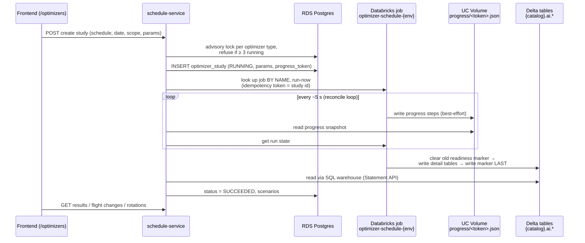
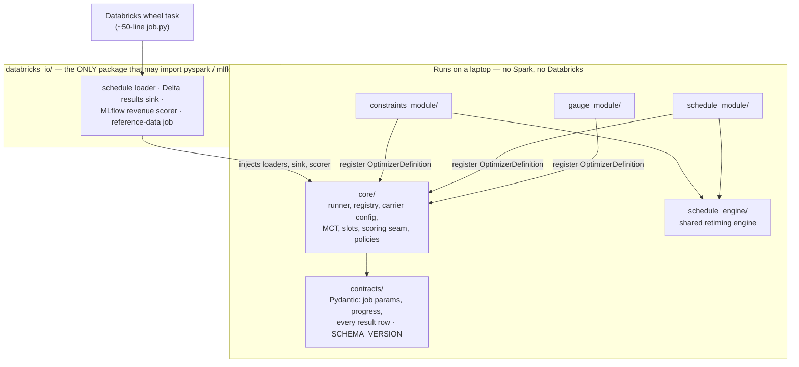
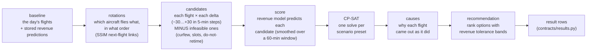
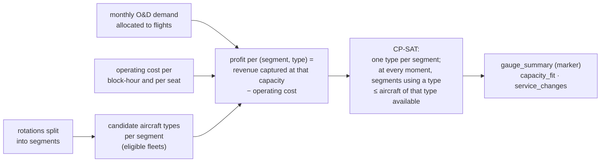

# 05 — The optimizers

*Written 2026-11-03 from `odysee-optimizers` (v0.3.0, ~21k lines of Python),
`schedule-service/schedule_service/services/optimizer_studies.py` and the frontend's
`optimisation` components. Confidence markers: **[code]**, **[docs]**, **[inferred]**,
**[ran]** (I executed it).*

---

## Layer 0: what they're for

Guest Disruptions, Connectivity and Revenue all *evaluate* a schedule a planner wrote. The
optimizers *propose changes* to one. There are three, all working on a single day of an existing
schedule:

| Optimizer | The planner's question | What it may change |
|---|---|---|
| **Constraint optimizer** (`constraints_module/`) | "If a rule gets tighter (turn times +15 min, a curfew, a longer MCT at SEA…), what's the least damaging way to adapt the schedule?" | Retime flights; cancel flights if it must |
| **Schedule optimizer** (`schedule_module/`) | "Under today's rules, can small retimes earn more revenue?" | Retime only, within ±15 or ±30 min; **never cancels** |
| **Fleet gauge optimizer** (`gauge_module/`) | "Are the right *sizes* of aircraft on the right routes?" | Upgauge, downgauge or swap aircraft types on rotation segments |

Each run is a **study**. A study produces several **options** (scenarios), one of which is
marked *recommended*, each with a list of changed flights and an explanation of why each flight
was treated the way it was.

---

## Layer 1: constraint programming, from first principles

You know SQL as a *declarative* language for data: you describe the result, the engine finds the
plan. **Constraint programming is declarative for decisions**: you describe the choices, the rules
and what "good" means, and a solver searches for the best combination. **CP-SAT** is Google
OR-Tools' solver for this, and it's what all three optimizers use.

A toy version of the retiming problem, with two flights flown by the same aircraft:

```
Variables (each is 0 or 1):
  A_-5, A_0, A_+5         "flight A moves by −5 / 0 / +5 minutes"
  B_-5, B_0, B_+5         same for flight B

Constraints:
  A_-5 + A_0 + A_+5 = 1                  each flight picks exactly one time
  B_-5 + B_0 + B_+5 = 1
  A_+5 + B_-5 ≤ 1                        A late AND B early would break the aircraft's turn time

Objective:
  maximise  1000·A_0 + 1020·A_+5 + 990·A_-5 + 800·B_0 + 830·B_-5 + 810·B_+5
            (each coefficient = predicted revenue of that flight at that time)
```

The solver returns the assignment with the highest objective that satisfies every constraint.
Here, A +5 and B −5 are each individually best, but together they break the turn, so it picks
the best compatible pair. With hundreds of flights and a dozen time options each, the
combinations explode beyond brute force. CP-SAT uses SAT-solver techniques to prune the search
and returns the best answer found within a time limit, along with whether it *proved* that answer
optimal.

Three things follow, and you'll see them everywhere in the code:
1. **Everything must be integer.** Revenue in dollars is scaled and rounded
   (`revenue_objective_scale`).
2. **Results depend on the solver version.** Different versions explore differently. That's why
   `ortools` is pinned and must never be bumped casually (AGENTS.md rule 2), and why there are
   "golden" baseline files in `tests/`.
3. **The model is only as good as its coefficients.** The solver optimises *predicted* revenue.
   If the prediction is wrong, the optimum is wrong (see Layer 4).

---

## Layer 2: how a study flows through the system



Patterns worth noticing:

- **The job is found by name**, not by ID (`optimizer-schedule-dev`). Deploying a new version
  never requires reconfiguring the API, and the service records `solver_version` and
  `schema_version` from the job's metadata on every study.
- **`pg_advisory_xact_lock`** caps concurrent studies per optimizer type (default 3). It's a named
  lock held for the transaction, like MySQL's `GET_LOCK()`, scoped to the transaction.
- **Idempotency token = study id**, so a retried launch can never start two runs.
- **Progress is a JSON file**, not a database row (`contracts/progress.py`). The job writes it
  best-effort, and a failure to write progress must *never* fail a solve (AGENTS.md rule 6). If the
  file is missing or older than 2 minutes, the API falls back to the Databricks run state.
- **The readiness marker.** Each optimizer names one table (e.g.
  `schedule_optimizer_scenario_summary`) that the runner deletes first and writes last
  (`core/runner.py`). The API treats a study as finished only when that marker has rows, so it
  can never read a half-written result. It's the same idea as writing a file to `tmp` and then
  `rename()`ing it.
- **Results come from a SQL warehouse, not Lakebase.** Unlike Guest Disruptions, the API queries
  the Delta tables directly via the Databricks SQL Statement API
  (`database/optimizer_results_repository.py`), with a single-flight cache in front. **[code]**

---

## Layer 3: code architecture — ports and adapters



- **`core/runner.py` is the whole lifecycle in ~100 lines.** Validate params → load carrier
  config → load schedule → `solve()` → write tables (marker last) → mark progress done. Its
  dependencies (`load_schedule`, `sink`, `make_reporter`) are *functions passed in*, so the
  identical lifecycle runs in pytest with in-memory fakes and on Databricks with Spark. If you've
  used dependency injection in Perl via constructor arguments rather than a framework, it's that.
- **`core/registry.py`**: adding an optimizer means registering one `OptimizerDefinition`
  (`key`, params model, `solve`, readiness table). No new job plumbing.
- **"Carrier is data."** Fleets, equipment aliases, turnaround minimums, MCT, curfews and slots
  come from a reference-data job that reads the carrier's tables. A literal like `"B737-800"` in
  `src/` is a bug (rule 4). The schedule-service side doesn't fully follow this: it hard-codes
  `OPTIMIZER_CARRIER_BY_AIRLINE = {"XE": "jsx"}`.
- **Contracts are versioned like an API.** Any change under `contracts/` bumps
  `SCHEMA_VERSION` in the same PR (additive = minor, breaking = major).

---

## Layer 4: the retiming engine (constraint + schedule optimizers)



### The model (`schedule_engine/model.py`)

| Element | Encoding |
|---|---|
| Decision per flight | Booleans `x[flight, delta]` for each *feasible* delta, plus `cancel[flight]`; **exactly one** is true |
| Hard rules like curfews | **Not constraints at all.** An infeasible time simply has no variable ("feasibility as candidate existence", `candidates.py`). Smaller model, faster solve |
| Untouched aircraft lines | Frozen at delta 0 |
| Cancellation | Cascades forward along the aircraft's line: `cancel[prev] ≤ cancel[next]`. An aircraft that ends the day in the wrong city costs extra ("out of position") |
| Turn times | Pairwise incompatibilities: `x[prev, d1] + x[next, d2] ≤ 1` for every pair of times that leaves too little ground time |
| Connections | A `connection_active` boolean per passenger connection, forced off if either flight is cancelled; when active, `buffer ≥ MCT` and `buffer ≤ max` (`OnlyEnforceIf`) |
| Objective | maximise Σ (predicted revenue − retime penalty + connection value) · x − cancellation cost |

**A two-pass solve.** Some flights *must operate* (under a do-not-retime rule, or because a
later leg on the same aircraft depends on them), and occasionally they can't satisfy every rule.
The engine first **minimises the number of such conflicts**, then adds "conflicts ≤ that
minimum" as a constraint and solves again **maximising revenue**. That's lexicographic
optimisation: safety first, money second, never trading one against the other.

### Presets = options

Each preset is a separate solve with different knobs:

| Optimizer | Option | Knob |
|---|---|---|
| Constraint | *Protect Connectivity* | high value on keeping connections |
| Constraint | *Minimize Schedule Change* | connection weight 0 |
| Schedule | *Conservative (±15 min)* | retime window capped at 15 |
| Schedule | *Extended (±30 min)* | retime window capped at 30 |

The constraint optimizer's tightenable rule families are: turn time, curfew, MCT, ground time,
gating, slot, metering, do-not-retime and bank (`ConstraintFamily` in
`contracts/job_params.py`).

### Where the revenue numbers come from — and the honest caveat

Each candidate (flight × delta) is scored by the **same ML revenue model** used for schedule
revenue elsewhere, behind a `RevenueScorer` seam (an MLflow model on Databricks, a stub in
tests). The code is unusually frank about the model's limits (`core/revenue_smoothing.py`):

> the revenue models … encode departure and arrival time as whole local hours. Their prediction
> is flat inside an hour and jumps at the hour … (a JSX flight moved 19:00 → 18:55 gained 69 %
> of its revenue).

The workaround is to average the prediction over a 60-minute window centred on the candidate time (±30 min, `revenue_smoothing_minutes`), explicitly labelled a
*temporary stopgap* that "does not make the model's hour effect causal or right". So **the
retiming optimizers optimise against a model that doesn't really understand minutes.** The
recommendation step compensates with tolerance bands: options whose revenue gap is smaller than
the model's error are treated as ties and decided on operational criteria
(`recommendation.py`, `docs/revenue_recommendation_policy.md`). That's good practice, and also a
signal of how much uncertainty is in the revenue numbers.

---

## Layer 5: the fleet gauge optimizer

A different, smaller model (`gauge_module/model.py`, ~300 lines):



The fleet-size constraint is a classic resource constraint. At every start or end time, count
the segments in the air on type *g* and require that to be ≤ the number of type-*g* aircraft in
the baseline. Upgauging one route therefore forces a downgauge elsewhere. Actions are
`UPGAUGE`, `DOWNGAUGE` and `SWAP`. The summary lists the assumptions the solver **enforces** and
those it **doesn't** (`assumptions_enforced` / `assumptions_not_enforced`), which is honest
reporting a planner can act on. Rotation segments are currently *reconstructed*; the
`rotations.py` docstring says this "will be replaced by next flight SSIM file when available".

---

## Layer 6: working on it

```bash
cd ../odysee-optimizers
uv sync --all-extras --python 3.12      # see finding 1
uv run --python 3.12 pytest             # 1107 tests, ~2.5 min, no Databricks needed
```

**[ran]** 1,107 passed, 1 skipped, coverage 90.86% (gate: 80%).

To try against real data without disturbing anyone, use the `personal` Databricks target: your
own copy of each job, writing tables prefixed `dev_<you>_` (README, "Testing on Databricks
without touching shared dev"). Releases use release-please plus a `/rc` comment on the Release
PR. The README covers this well.

---

## Findings

1. **`uv sync` fails on Python ≥ 3.13.** `requires-python = ">=3.11"`, but the pinned
   `ortools==9.10.4067` only ships wheels for CPython 3.11 and 3.12, and the repo has no
   `.python-version` file. On a machine whose default Python is 3.13 you get "doesn't have a
   source distribution or wheel for the current platform". Fix locally with `--python 3.12`; a
   one-line `.python-version` (or `requires-python = ">=3.11,<3.13"`) would fix it for everyone.
   **[ran]**
2. **The revenue model's hour-granularity** (Layer 4) is the biggest caveat on the retiming
   optimizers' output. It's acknowledged and mitigated, not solved.
3. **The API reads the legacy catalog by default**: `OPTIMIZER_CATALOG =
   "alaska_sierra_dev_catalog"` (`schedule-service/settings.py:100`), not the new
   `<tenant>_<env>` catalogs from 04. Expected mid-migration, but a dependency to track.
4. **The frontend mock switches look stale.** `mocks/config.ts` says the optimisation
   `results`, `flightChanges`, `rotations` and `decision` endpoints are "still mocked until the
   backend serves them", but schedule-service already implements `get_results`,
   `get_flight_changes`, `get_rotations` and `set_decision`. Outside local dev, mocks are
   only active when `NEXT_PUBLIC_ENABLE_MOCKS=true`. That's a Vercel setting not visible in the
   repo, so **I can't tell whether any deployed environment shows mocked optimizer results.** Worth
   asking. **[code; deployment state unknown]**
5. **Time limit mismatch, harmless.** The job default is 90 s (`time_limit_seconds`), but the API
   always sends `OPTIMIZER_TIME_LIMIT_SECONDS = 300`. Worth knowing when you see a run take 5
   minutes.
6. **Quality signals are strong here.** It's the only repo I've seen so far with strict mypy,
   a coverage gate, golden baselines and contracts versioned like a public API. If you want a
   model of "how we'd like code to look", this is it.

---

## Good next steps

- Read `core/runner.py` (100 lines), then `schedule_engine/model.py:281-600` with the toy example
  above in mind.
- Run a single test file with output to watch a solve:
  `uv run --python 3.12 pytest tests/schedule_engine/test_model.py -q`.
- Read `docs/README_JSX_TECHNICAL.md` for a complete worked example on a second carrier (JSX).
