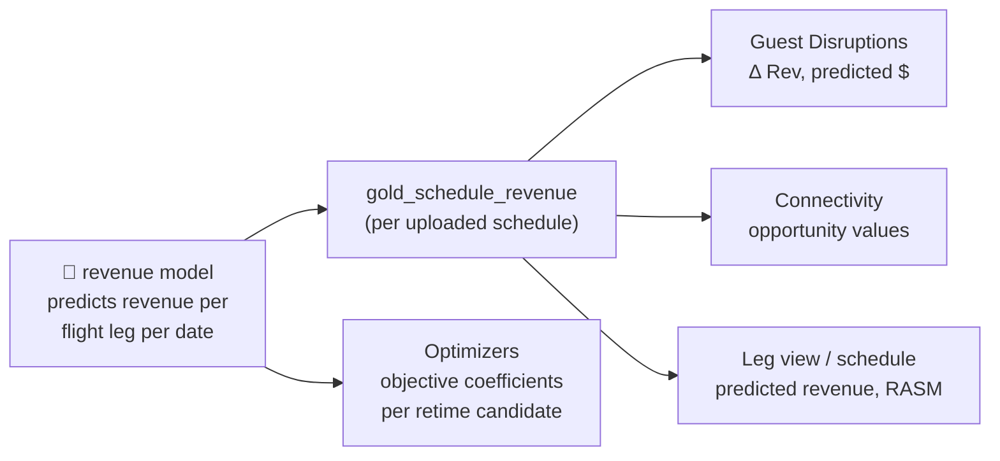
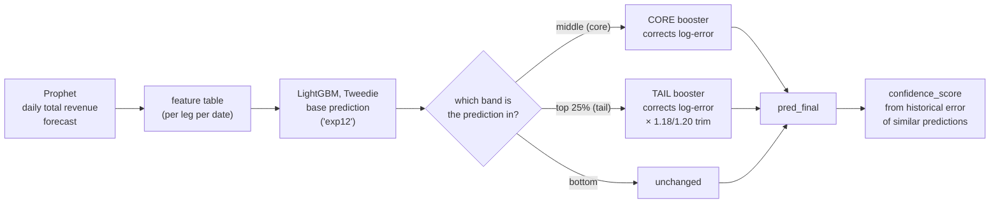
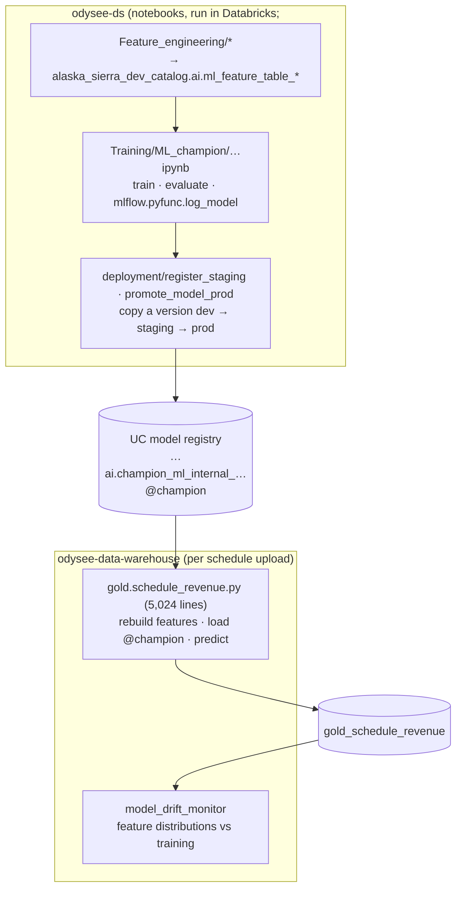

# 06 — The revenue models

*Written 2026-11-03 from `odysee-ds` (notebooks), `odysee-data-warehouse` (inference, drift) and
`odysee-optimizers` (industry scoring, recommendation policy). `odysee-mlops`, the repo meant to
own models (infra `adr/00021`), is not accessible to me. Confidence markers: **[code]**,
**[docs]**, **[inferred]**. Notebook source was read with [`tools/nbcode.py`](../tools/nbcode.py).*

**Why this matters:** almost every dollar figure in the product starts here: predicted flight
revenue on the schedule, "Δ Rev" on Guest Disruptions, connection opportunity values, and the
coefficients the optimizers maximise. The model's quality bounds the quality of every
recommendation.

---

## Layer 1: machine learning from first principles

You've written plenty of code that computes an answer from rules. **Supervised learning**
inverts that: you supply many examples of inputs and the correct answer, and an algorithm
*fits* a function that maps one to the other.

| Term | Meaning here | Analogy |
|---|---|---|
| **Row / example** | One flight leg on one date | A row in a MySQL table |
| **Target** (label, *y*) | The number to predict: revenue on that leg that day | The column you wish you had for future rows |
| **Features** (*X*) | Everything known in advance: route, departure hour, distance, seats, day of week, competitor capacity, connections… | The other columns |
| **Training** | Searching for the function that best maps X → y on past rows | Fitting a curve, at enormous scale |
| **Model** | The fitted function, saved as a file | A compiled lookup/decision procedure |
| **Inference / scoring** | Running the model on new rows (a planner's proposed schedule) | Calling the function |

**The central danger is overfitting**: a model can memorise its training rows and look perfect
on them while being useless on new ones. So you always hold back data the model never saw and
measure it there. For time-series problems like this one, the held-back data should be *later
in time* than the training data, because in production you always predict the future.

**Gradient-boosted trees (LightGBM).** A decision tree is a nested `if/else`
("if haul > 1500 mi and hour < 7 then …"). Boosting builds hundreds of small trees, each one
trained to correct the *remaining errors* of all the trees before it, and adds their outputs. It
works well on tabular data like this and is the industry default for it.

**Tweedie objective.** It tells LightGBM what "error" means. Tweedie suits targets that are
never negative, often small and occasionally huge, like revenue.

**WAPE** (weighted absolute percentage error) = Σ|actual − predicted| / Σ|actual|: roughly
"what fraction of the dollars did we get wrong". This is the team's headline metric.

**Prophet** is a curve-fitting library for time series: trend + weekly cycle + yearly cycle +
holidays. Here it forecasts *total daily revenue*, which is then fed to LightGBM as a feature
(a "how busy is the season" signal).

**MLflow / model registry.** A versioned store of model files, like a package registry. A model
has numbered versions and **aliases** (`@champion`), which work like a git tag that can be moved
to a new version. Code that loads `models:/name@champion` gets whichever version currently holds
the alias.

---

## Layer 2: the production model ("internal champion")

| | |
|---|---|
| **Registered name** | `<catalog>.ai.champion_ml_internal_lightgbm_with_conn_full_network_with_confidence_score`, one copy per environment's catalog (`odysee-data-warehouse/resources/environments/*.tfvars`, `ml_model_name`) |
| **Loaded as** | `models:/…@champion` (`gold.schedule_revenue.py:163-171`) |
| **Training notebook** | `odysee-ds/Training/ML_champion/champion_internal_ml_with_conn_with_confidence_score.ipynb` (~6,300 lines of code) |
| **One row** | One flight leg on one departure date, carriers **AS and HA** only |
| **Target** | `rev_passenger`, which is **total revenue allocated to the leg**, despite the name: `gold.fact_leg_rasm.leg_allocated_revenue_amt`, renamed (`Feature_engineering/Historical_data/1.0)…ipynb`) |
| **Training data** | Departures 2024-02-01 → 2025-03-31 (≈14 months, about one seasonal cycle) |
| **Test / validation** | Test 2025-04 → 2025-07; validation 2025-08 → 2025-12 |
| **Contract version** | `2026-05-25__cal03a_network_graph_resid_tq075__exp12_core_tail__uncertainty_v3` |

### Feature families

From the feature-engineering notebooks and the inference code **[code]**:

- **Schedule and time:** departure hour, day of week, week of year, month, encoded as *cyclic*
  features (sine/cosine pairs, so 23:00 is "close" to 00:00); red-eye flag; lead time.
- **Route shape:** stage length, haul class, Hawaii market, Latin America by season, "warm
  destination", route age/maturity.
- **Calendar:** US holidays (Easter, Memorial Day, Thanksgiving… computed in code), peak
  regimes, a Prophet forecast of total daily revenue with rolling averages.
- **Network/connectivity:** feasible inbound/outbound connections, reachable O&D pairs, bank
  sizes (from a graph-based feature table).
- **Competition:** competitor seats per hour and Alaska's market share by flights and by seats.

### The model is a stack, not one model

The CORE and TAIL "boosters" are second-stage LightGBM models that learn the base model's
remaining error on the log scale, separately for mid-range and high-revenue flights. The
**confidence score** is computed from how wrong the model historically was for predictions in
similar buckets. It's a useful ranking signal, **not a calibrated probability**. **[code]**

---

## Layer 3: lifecycle — from notebook to production

Things to notice:

- **Promotion is a manual notebook.** `register_staging.py.ipynb` copies a version from the dev
  registry into staging, and `promote_model_prod.py.ipynb` copies staging into prod. The version
  is hard-coded (`STAGING_VERSION = "1"   # <- adjust when needed`). There's no CI and no
  approval step in the repo.
- **Features are built twice.** Training computes features in `odysee-ds`; inference
  re-implements the same functions in the warehouse (`add_hawaii_market_inplace` in training
  becomes `_add_hawaii_market_inplace` in inference, and so on). Nothing checks that the two
  stay identical. This is the classic **training/serving skew** risk: if they drift apart, the
  model silently receives inputs it was never trained on.
- **Drift monitoring exists but is paused** in staging and prod
  (`model_drift_monitor_pause_status = "PAUSED"`); it runs in dev.

### Other models you'll meet

| Model | Where | Used for |
|---|---|---|
| `…champion_ml_lightgbm_with_conn_with_confidence_score` | Loaded by `silver.disrupted_revenue_prediction_leg.py` (in `star_schema_job`), name hard-coded and pinned to a version. The Terraform variable `ml_disrupted_leg_model_name` is set in every environment but **never passed to any job** | Per-leg revenue predictions for disrupted legs; apparently an earlier sibling of the champion **[inferred from naming]** |
| **Industry model** (JSX) | `odysee-optimizers/pipelines/jsx-revenue-prediction` + `odysee-ds/Training/ML_champion/industry_revenue_model_train_register.py` | Carriers whose own revenue data we don't have (demo/JSX), trained on industry ticket data (ARC DDS). Packaged properly: versioned profiles, quality limits and a **`test_feature_parity.py`** |
| New Zealand variants | `odysee-ds/*/New_zeland`, `NZ_*` | Prospect/analysis work; not wired into the warehouse that I can see **[inferred]** |

The JSX pipeline is the direction the team is clearly heading: a wheel with tests, versioned
transformation profiles and an explicit parity test between training and serving features.

---

## Layer 4: how much to trust the numbers

These are reading-the-code observations, not a verdict on the model. Several are already known to
the team (they wrote the caveats themselves). Treat this as a list of questions for the data
science team.

1. **The evaluation design is unusual.** The validation period (Aug–Dec 2025) is *later* than
   the test period (Apr–Jul 2025). Validation is used for early stopping, and **the CORE/TAIL
   correction boosters and their band thresholds are fitted on the validation rows**. So
   validation metrics after correction are in-sample (optimistic), and the only clean
   evaluation, test, measures the model on a period *earlier* than data it learned from. Nothing
   simulates the real production situation: train up to T, predict schedules months after T.
   **[code; interpretation is mine]**
2. **About one seasonal cycle of training data** (Feb 2024 → Mar 2025). Holiday and seasonal
   effects get roughly one example each.
3. **Departure time is learned as whole hours** (from 05): flat within an hour, jumps at the hour.
   The optimizers smooth it as a "temporary stopgap" (`odysee-optimizers/core/revenue_smoothing.py`).
4. **The optimizers' "too close to call" tolerance isn't measured yet.**
   `docs/revenue_recommendation_policy.md`: *"No measured threshold is activated by this
   implementation."* Everything runs on a provisional 1%.
5. **Hand-tuned constants** in the final stack (tail band at the 75th percentile, ×1.18/1.20 on
   the tail). Normal in iterative modelling, but they're decisions baked into a notebook, not
   documented anywhere I found.
6. **No accuracy numbers in git.** Notebook outputs are stripped repo-wide (zero outputs in any
   notebook: good hygiene for client data), so WAPE figures only live in MLflow experiments
   (`/Shared/champion_ml_lightgbm_with_conn_with_confidence_score`). Ask for the latest test WAPE
   and how it was computed.
7. **The promotion path for the production model isn't in the repo.** The promotion notebooks
   name `champion_ml_lightgbm_with_conn_with_confidence_score` (the older disrupted-leg model, still
   used by `silver.disrupted_revenue_prediction_leg.py`), not the `…_internal_…_full_network_…`
   model that schedule revenue loads. How the latter reached staging
   and prod, and who moves `@champion`, is a question for a human. **[code; gap]**
8. **Training reads the legacy dev catalog** (`alaska_sierra_dev_catalog.*`), which holds real
   Alaska data. The new infra rules (04) say dev holds "no client data of any kind". This will
   have to be reconciled as models move to `odysee-mlops` and the tenant catalogs' `features`
   schema. **[inferred]**
9. **Code shape.** Training is ~5–6k-line notebooks per variant (AS, NZ, industry), largely
   copy-and-modify, with no tests; some comments are in Portuguese. That's typical of a research
   codebase, and the reason the warehouse's AGENTS.md and the JSX pipeline look the way they do.

None of this means the predictions are bad. It means **the system has no in-repo evidence of how
good they are on future schedules**, and that's the first thing I'd want to see before trusting
a "+$40k" recommendation.

---

## Questions to bring to the data science team

- What's the current champion's test WAPE, and on what period? Is there a forward-in-time
  backtest (train ≤ T, evaluate T+3 to T+9 months)?
- Who moves `@champion` in staging/prod, and what's the checklist?
- Is there a plan to share one feature-building library between training and inference
  (like the JSX pipeline's parity test)?
- Why is drift monitoring paused in prod?
- When does the model learn continuous departure time (so revenue smoothing can go)?

(Also recorded in [open-questions.md](open-questions.md).)
