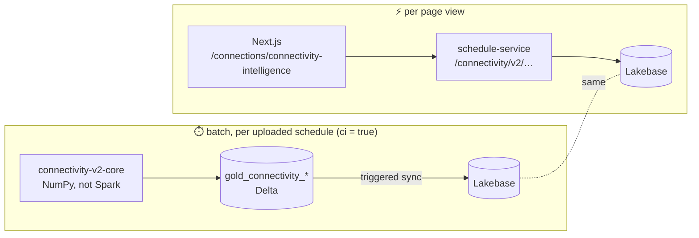
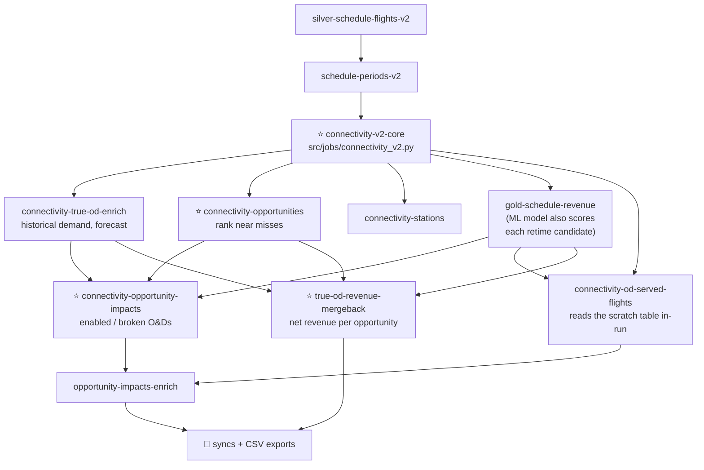
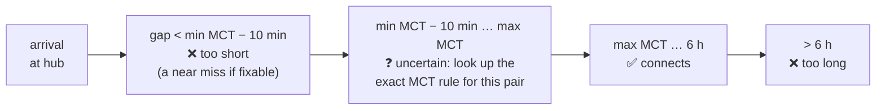

# 07 — Connectivity Intelligence, top to bottom

*Written 2026-11-03. Same shape as [03 Guest Disruptions](03-guest-disruptions.md): read that
first, because the request path and the batch DAG are shared. Confidence markers: **[code]**,
**[docs]**, **[inferred]**.*

**The questions this product answers:**
1. **Network:** *Which origin–destination markets does this schedule serve, nonstop or with one
   connection, in each period and on each weekday, and what changed versus another schedule?*
2. **Opportunities:** *Which connections **almost** work, how far would a flight have to move to
   make them work, what else would that move break, and what's it worth?*

---

## Layer 0: same architecture as Guest Disruptions

Everything from 03 applies: TanStack Query → Server Action → FastAPI → SQL on Lakebase; batch
results synced at the end of the run. Only the differences are covered below.

---

## Layer 1: the frontend

`odysee-frontend/apps/web/src/app/(main)/connections/connectivity-intelligence/page.tsx` **[code]**

| Tab | Shows | Main API routes |
|---|---|---|
| **Network** | Grid of O&D markets for a period: served/unserved, nonstop vs 1-stop counts, historical demand, forecast, revenue; drill into the flights behind an O&D; compare with another schedule (gained/lost markets) | `…/ods`, `…/ods/summary`, `…/ods/flights`, `…/ods/compare`, `…/ods/flights/compare`, exports |
| **Opportunities** | Ranked "retime flight X by N min to create connection A→B→C", each expandable to what it **enables** and **breaks**, with net revenue | `…/opportunities`, `…/opportunities/impacts`, exports |

**Feature flags come from Clerk.** `connectivityIntelligenceFlag`, `ciOpportunityRevenueFlag`
and the Guest Disruptions flags in 03 all resolve from the **Clerk organization's metadata**
(one organization = one customer airline), optionally overridden per user, defaulting to off
(`apps/web/src/flags.ts:17-38`). Product access is configured per customer in Clerk, not in code.

Frontend leftovers:
- A **Stations** section exists (`components/…/stations/`) with mocks, but it isn't one of the
  page's tabs, and the backend has no `connectivity-intelligence/…/stations` route. It's unfinished
  or parked.
- The older **Network Overview** page (`/network/overview`, behind `networkOverviewFlag`) calls
  v1 routes (`connectivity/{schedule}/{period}`, `…/schedule-summary`) that **schedule-service no
  longer serves**: only `/connectivity/v2` exists (`api/connectivity.py:41`). Probably dead behind
  its flag.

---

## Layer 2: the API

`schedule-service/schedule_service/services/connectivity.py` (~2,500 lines) reads 8 Lakebase
tables:

| Table (Lakebase) | Grain | Feeds |
|---|---|---|
| `gold_connectivity_true_od` | schedule × period × weekday × O&D | Network grid, summary |
| `connectivity_od_served_flights` | one 1-stop connection *pattern* (two flights, same local times, same hub) × weekday × period; operating dates nested as JSONB | O&D drill-down (1-stop list) |
| `gold_connectivity_opportunities` | opportunity (rank 1–5 per period × weekday × O&D) | Opportunities list |
| `gold_connectivity_opportunity_impacts` | one affected O&D per opportunity (`enabled` / `broken`) | Expanded row |
| `gold_connectivity_opportunity_revenue_dates` | per-date revenue of an opportunity | Revenue detail |
| `gold_historical_od_daily`, `gold_schedule_revenue`, `gold_disrupted_period` | supporting | Demand history, revenue, period list |

The O&D drill-down's **nonstop** list isn't stored. The API computes it live from
`silver_scheduled_flights`, because nonstops are trivial to derive while 1-stops depend on the MCT
engine (`gold.connectivity_od_served_flights.py` header). **[code]**

---

## Layer 3: the batch branch

Inside the master DAG from 03 (`resources/schedule_flights_v2_job.tf`), with `ci = true`:

If both `ci` and `gd` are off, a lightweight `basic-connections` task runs instead of the core.

---

## Layer 4: the algorithm

### 4a. What "served" means

A **true O&D** (e.g. PDX→FAI) is served on a given weekday in a period if the schedule offers
**a nonstop or a valid one-stop connection**. A one-stop A→H→B is considered only if:

- **circuity ≤ 1.5**: the routed distance is at most 1.5× the direct distance (no PDX→MIA→FAI);
- the gap at the hub is **≥ MCT** (minimum connecting time, from the rule table in 02);
- the gap is **≤ 6 hours** (`SERVED_HI`).

Only one-stop connections count. Two-stop itineraries are never "served" here.

### 4b. Finding connections fast: sorted arrays and binary search

For each hub and each pair of routes (inbound A→H, outbound H→B), the core takes the sorted
arrival times and sorted departure times, and for each arrival uses NumPy `searchsorted`
(binary search) to find the slice of departures falling inside each time zone. It's the same
idea as an index range scan in MySQL, done on in-memory arrays. Each arrival's timeline is cut
into bands:

Only the uncertain band pays for the expensive MCT rule resolution (carrier, terminal, aircraft
body, region…), and each unique combination is resolved once for the whole schedule ("Loop 1"),
then reused per period ("Loop 2"). Counts are bucketed by the **local weekday of the first leg**.
Periods run in parallel with Python `multiprocessing`. **[code: `jobs/connectivity_v2.py`]**

### 4c. Opportunities = near misses

When a connection is too short, its **deficit** = MCT − gap is how much later the second flight
would have to leave. Deficits up to **30 min** are "quick wins" and up to **6 h** "moderate".
For each (period, weekday, O&D) the pipeline keeps **one instance per flight pattern** and ranks
the **5 smallest retimes** (`gold.connectivity_opportunities.py`).

### 4d. Impacts = what else the move does

Moving a flight affects every connection it's part of. For each opportunity,
`gold.connectivity_opportunity_impacts.py` lists the O&Ds it **enables** and the ones it
**breaks**, with flags a planner cares about: new market served, completes a round trip, added
frequency, only daily connection lost, reduced frequency, and whether the market has other-airline
service.

### 4e. Value = re-scoring with the revenue model

Net revenue (`gold.connectivity_true_od_revenue_mergeback.py:162-200`) comes from the **ML
revenue model of 06** scoring both flights before and after the move:

- **leg 1**: predicted revenue gain on the first leg (and on every other first leg the retime
  connects), because more connections now feed it;
- **leg 2**: the moved flight's own predicted change, from both its new clock time and its new
  connectivity features;
- summed over the dates the connection actually runs. A flight shared by several opportunities
  has its change split evenly across them.

---

## Findings

1. **Schedule processing is serialized environment-wide.** The core writes its pair-level results
   to one scratch table, `gold.connectivity_temp_connections`, with `mode("overwrite")` of the
   *whole table* (`jobs/connectivity_v2.py:1155-1162`), and a later task must read it before the
   next run overwrites it. That's only safe because the master DAG has `max_concurrent_runs = 1`
   with queueing. Consequence: **every upload in an environment, from every user, runs strictly
   one at a time.** A long GD + CI run delays everyone behind it. **[code; impact inferred]**
2. **Opportunity values use the unsmoothed revenue model.** The optimizers smooth the model's
   hour steps (05/06), but the warehouse scoring has no smoothing. A 10-minute retime that crosses
   an hour boundary can pick up the full hour-to-hour jump in predicted revenue. The same move can
   be valued differently by Connectivity and by the optimizers. **[code: absence of smoothing;
   effect inferred]**
3. **"Valid connection" means different things in different products.**

   | | Max connection | Max flights |
   |---|---|---|
   | Connectivity | 6 h for every connection type | 2 (one stop) |
   | Guest Disruptions matching | 6 h domestic→domestic, **12 h** otherwise | as booked |
   | Disruption alternatives | 6 h / 12 h | 3 |
   | Optimizers | from carrier reference data | — |

   An international itinerary with an 8-hour connection is a valid trip in Guest Disruptions and
   "too long / unserved" in Connectivity. **[code]**
4. **Only one kind of fix is surfaced.** The core also finds connections that are too *long* and
   could be fixed by moving a flight earlier (negative retime), but the opportunities step keeps
   only `retime_minutes > 0` (`gold.connectivity_opportunities.py:44`). Opportunities are
   therefore always "move a flight later to cover an MCT shortfall". **[code]**
5. **Heavy computation on one machine.** The core is NumPy + `multiprocessing` on the cluster
   driver, not distributed Spark. Fast for one airline's schedule; a scaling question as tenants
   and network size grow. **[inferred]**
6. **Frontend debris:** the Stations section has mocks but no backend and no tab; the Network
   Overview page calls v1 routes the backend no longer has.
7. **Not yet in the new platform.** `odysee-data-platform/contracts/platform/connectivity_core.yaml`
   is a draft: *"Promotion from Connectivity Intelligence is proposed, not decided."*

---

## Good next steps

- Read the docstring and Loop 2 of `odysee-data-warehouse/src/jobs/connectivity_v2.py`
  (lines 1-60 and 424-620) with the band diagram above.
- Read `gold.connectivity_true_od_revenue_mergeback.py:162-200`. The comment block is one of the
  clearest explanations of a business rule in the codebase.
- Ask: is the global serialization (finding 1) a known throughput limit, and is "valid
  connection" meant to differ between products (finding 3)?
