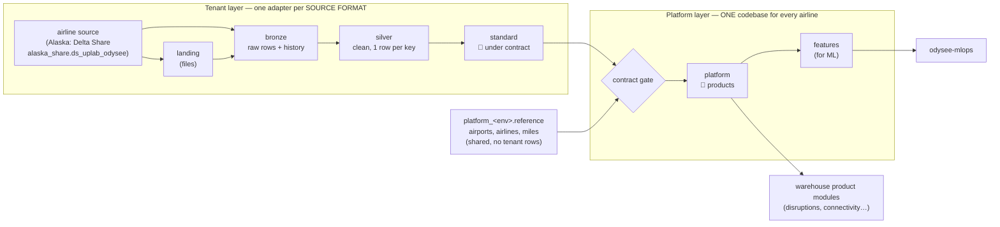
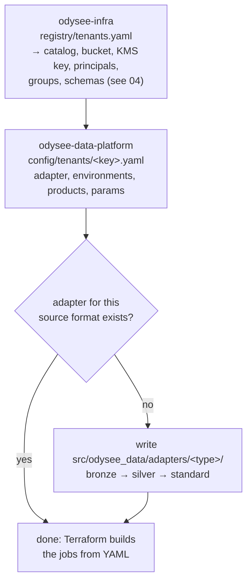
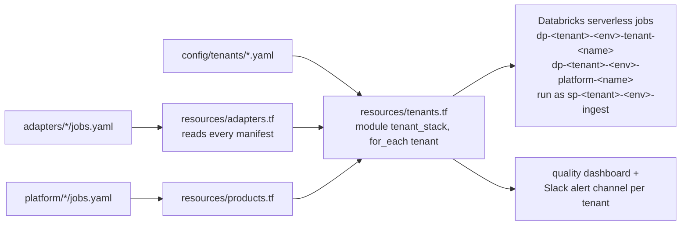

# 08 — The data platform: tenants, adapters and contracts

*Written 2026-11-03 from `odysee-data-platform` (≈10k lines of Python, 43 contracts, 9 ADRs) and
its links to `odysee-infra` and `odysee-data-warehouse`. Confidence markers: **[code]**,
**[docs]**, **[inferred]**, **[ran]**.*

**Why it exists:** the warehouse (02–07) was built for one airline. Alaska's table names, carrier
codes, loyalty rules and quirks are written into hundreds of pipelines. Onboarding a second
airline that way would mean forking everything. This repo is the fix: **airline-specific code is
confined to an "adapter", and everything after it is shared, tenant-agnostic code.**

---

## Layer 0: the shape



The pivotal layer is **`standard`**. It's the *published interface* of an adapter: once Alaska's
bookings and British Airways' bookings both arrive as `standard.booking_segments` v1.x, every
product downstream works for both without change.

If you've written a DBI driver in Perl, this is the same pattern: `DBD::mysql` and `DBD::Pg` are
the adapters, the DBI interface is `standard`, and application code is the platform layer.

---

## Layer 1: what "a tenant" is, across three repos

Adding an airline touches three places, and only one of them is code:



**Alaska's config** (`config/tenants/alaska.yaml`) is a good read. Everything that used to be a
constant in the warehouse is a parameter:

| Param | Was | Used by |
|---|---|---|
| `carriers_primary: AS,HA`, `carriers_regional: QX,OO`, `carrier_priority` | `carriers.py` constants | `standard.carrier_profile` |
| `elite_loyalty_tiers: GLD,G75,G1K,EMERALD,SAPPHIRE`, `group_size_threshold: 10` | hard-coded | `platform.itineraries` |
| `mileage_point_value_usd: 0.008` | `MILEAGE_POINT_VALUE_USD` | revenue facts |
| `preclearance_airports: YVR,YYZ,…` | `PRECLEARANCE_AIRPORTS` | schedule network |
| `require_ticketed_segments: true` | Alaska's guidance | adapter silver |

**Status of tenants [code]:**

| Tenant | In infra registry | Has config here | Has adapter |
|---|---|---|---|
| Alaska | ✅ dev/staging/prod | ✅ | ✅ `alaska_dap_share` |
| British Airways | ✅ prod (eu-central-1) | ❌ | ❌ |
| Odysee Airway (synthetic) | ✅ dev/staging | ❌ | ❌ |

So BA has a catalog, bucket and principals provisioned in AWS, but no data pipeline yet.

---

## Layer 2: one dataset, end to end

Following Alaska's bookings into `standard.booking_segments`:

| Step | File | What it does |
|---|---|---|
| Job definition | `adapters/alaska_dap_share/jobs.yaml` → `bookings` | Three tasks, bronze → silver → standard; each lists its tables as `for_each` steps, so a **repair run reruns only the failed tables** |
| Bronze | `bronze/bookings.py` | Copies 10 DAP share tables, keeping history (type 2 via hashed MERGE, `platform/_lib/scd.py`) |
| Silver | `silver/bookings.py` | One current row per key, cleaned; drops unticketed segments (`require_ticketed_segments`) |
| Standard | `standard/bookings.py` + `standard/transforms.py` | **Pure renames and casts** from Alaska's vocabulary (`departure_date_time_stn_local`) to the contract's (`departure_local_at`), then `publish()` |
| Contract | `contracts/standard/booking_segments.yaml` | Columns, key, expectations, freshness SLA, consumers |
| Consumer | `platform/itineraries/` (job `dp-alaska-<env>-platform-itineraries`) | First task: the **contract gate** |

### The contract, and what enforces it

```yaml
dataset: booking_segments
version: 1.0.0
primary_key: [booking_id, segment_sequence]
expectations:
  - name: segment_key_present
    sql: booking_id IS NOT NULL AND segment_sequence IS NOT NULL
    action: fail      # abort the write
  - name: airports_present
    sql: departure_airport_code IS NOT NULL AND arrival_airport_code IS NOT NULL
    action: drop      # move bad rows to quality.quarantine_standard_booking_segments
freshness_sla: PT24H
consumers: [platform.itineraries]
```

- **On write** (`platform/_lib/quality.py`), every expectation is evaluated in one aggregation.
  `fail` aborts, `drop` quarantines the rows, `warn` records a count. Every run appends evidence
  to `quality.dq_results`. A NULL result counts as a failure, so a missing value never passes
  silently. Think of MySQL `CHECK` constraints plus a reject table plus an audit log.
- **On read** (`jobs/contract_gate.py`), every platform job's first task checks that its inputs
  are within a version range (`standard.bookings>=1.0,<2`) and fresh enough, and refuses to run
  otherwise.
- **Versioning:** a breaking change publishes a new major version side by side
  (`booking_segments_v2`) for a deprecation window, like an API.

### Guardrails in CI

| Check | Enforces |
|---|---|
| `make literals` | No airline name, catalog or carrier code anywhere outside the tenant's adapter and config (`scripts/check_literals.py`) |
| `make contracts` | Every `standard`/`platform`/`features`/`reference` table has a contract, and every adapter publishes what it claims |
| `make validate-config` | Tenant config agrees with odysee-infra's registry at a **pinned commit** (`config/registry.ref`); a product can only be enabled if the adapter publishes its required `standard` datasets |
| `core/naming.py` | Every catalog, table, job and principal name is derived from (tenant, env); building a name by hand is a review failure |

**[ran]** On this checkout: `make test` 255 passed (2 s); `make contracts` "43 (8 draft)";
`make literals` ok; `make validate-config` ok against `odysee-infra@b315c01a`, with one expected
warning (Alaska demo uses a legacy catalog). Spark tests: see findings.

---

## Layer 3: from YAML to running jobs



For each enabled tenant, Terraform merges the adapter's jobs with the enabled products' jobs, and
every job **runs as that tenant's ingest service principal**, the identity infra created, which
can only touch that tenant's catalog (04, Layer 4). Terraform never names an adapter or a tenant.

Deliberate differences from the warehouse (`odysee-data-platform/adr/00004.md`):
no Delta Live Tables; plain serverless jobs with hand-written SCD MERGE logic; every task is a
notebook that also imports as a plain module for tests.

---

## Layer 4: where the migration actually stands

`MIGRATION.md` lists every warehouse pipeline with a priority and a destination. The rule is
**move → run in parallel → reconcile → only then delete the old one**, and `scripts/` holds a
`reconcile_*.sql` per moved area. What the code shows today **[code]**:

- **Alaska writes to the new catalog only in dev.** `alaska.yaml` gives staging, prod and demo a
  `catalog_override` back to the legacy `alaska_sierra_<env>_catalog`.
- **No job runs on a schedule in any environment**: `schedules_paused: true` for dev, staging,
  prod and demo. Everything runs on demand.
- **Nothing downstream reads the new tables yet.** No pipeline in odysee-data-warehouse
  references a `standard.*`, `platform.*` or `alaska_<env>` table. The warehouse still runs
  entirely on its own pipelines, and so does everything in 03–07.
- Reference jobs are enabled only in dev (`reference_jobs_enabled = true` in `dev.tfvars`).

So: **the new platform is built, tested and runnable, but not yet in anyone's data path.**

---

## Findings

1. **Possible table collision under `catalog_override`.** In staging/prod the override points the
   adapter at the legacy catalog, and `naming.py` keeps the same schema and table names. So the
   adapter's bronze bookings table resolves to
   `alaska_sierra_staging_catalog.bronze.dap_current_bookings`, **the same table** the warehouse's
   DLT pipeline `bronze.dap_current_bookings.py` writes. Two writers to one table (one of them a
   DLT-managed table) would conflict or overwrite each other. Nothing scheduled triggers this today
   (schedules paused, and I can't tell whether staging/prod were ever released: no tags in this
   clone), and no doc I found addresses it. Worth raising before anyone runs an adapter job in
   staging or prod. **[code; consequence inferred]**
2. **Freshness SLAs vs. paused schedules.** Contracts declare `freshness_sla: PT24H` and the gate
   checks freshness, but no job is scheduled anywhere. Either someone runs them daily by hand, or
   platform jobs will refuse stale inputs once used. **[code; operating practice unknown]**
3. **BA is provisioned but has no pipeline.** Infra has a BA prod catalog in eu-central-1, but
   there's no BA config or adapter here. Whatever BA's source format is, it needs a new adapter
   before any product can run for them.
4. **The engineering quality is high**: contracts, quarantine with evidence, name derivation in
   one module, repair-friendly task steps, a literal-scan in CI, a config validated against the
   infra registry at a pinned commit, strict mypy, and fast unit tests. With the optimizers, it's
   the model for new work.
5. **The ADR index lists 00001–00003 as still "Proposed"**, including 00001, "Own the Tenant and
   Platform layers in a repository of their own", which is the decision the repo exists to carry
   out. Probably paperwork lag: infra's 00030 accepted the same thing.

---

## How to add a second airline (the checklist the code implies)

1. **Infra:** registry entry in `odysee-infra/registry/tenants.yaml` → catalog, bucket, key,
   principals, schemas. *(BA and Odysee Airway are already here.)*
2. Bump `config/registry.ref` to that infra commit.
3. If its source format is new: write `src/odysee_data/adapters/<type>/` with bronze → silver →
   standard, a `jobs.yaml` and a `publishes.yaml`. Only this directory may name the airline.
4. Add `config/tenants/<key>.yaml`: adapter, environments, params.
5. Enable products one at a time; `make check` refuses any whose inputs aren't published.
6. Merge → dev plans only that tenant's stack.
