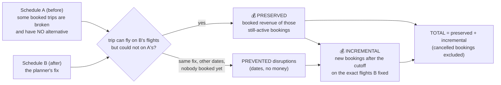
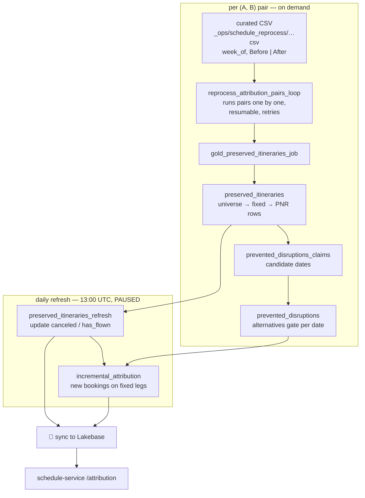

# 09 — Attribution ("Load Review" / Impact Dashboard)

*Written 2026-11-03. Builds on [03 Guest Disruptions](03-guest-disruptions.md): attribution reuses
its disrupted itineraries and alternatives. Confidence markers: **[code]**, **[docs]**,
**[inferred]**.*

**The question it answers:** *"Our schedule changes fixed trips that customers had already
bought. How much booked revenue did that save, and how much new booking did the fixed flights
attract?"* This is the product's ROI claim, the number most likely to appear in a sales deck or
a customer review.

---

## Layer 0: the idea in one picture

Attribution always compares **two uploads of the schedule**, A (before) and B (after):

| Term | Definition in code |
|---|---|
| **Universe** | Itineraries **disrupted in A** with **zero alternative pathways** (from 03's alternatives search), valid, with segments (`jobs/preserved_itineraries.py:110-143`) |
| **Fixed** | `can_fly_in_b AND NOT can_fly_in_a`: a valid chain of B's flights covers the booked trip, and none of A's did (`:500-520`) |
| **Preserved** | One row per (PNR, route) of a fixed itinerary, with its **booked revenue**, cabin, round-trip and other-airline flags, `has_flown`, `canceled` |
| **Prevented** | Other dates in the period where the *same* broken itinerary existed, nobody was booked, the same edit fixed it, and that day had no viable alternative. No money of its own (`gold.prevented_disruptions*.py`) |
| **Incremental** | Bookings created **on or after the cutoff** (`max_booking_date`) that fly the **exact physical legs** B fixed (flight number + local date + O&D, full path), on preserved paths or prevented dates. One row per (fix schedule, booking) (`jobs/incremental_attribution.py`) |

The money is always **booked revenue**: what passengers paid, from the bookings data. There is
no ML prediction anywhere in this product, which makes it easier to trust than 05–07's figures.

---

## Layer 1: what the user sees

`/reporting/impact-dashboard`, behind `loadReviewImpactFlag` (Clerk org metadata, see 07).

- **Summary:** total preserved + incremental revenue, PNRs, passengers, distinct routes.
- **Weekly table:** one row per ISO week, grouping schedules **by the week they were uploaded**;
  expand a week to see bookings by route, cancelled ones listed but counted at $0.
- **Export:** CSV of every week's detail.
- **Which schedules count** is an admin switch: `show_attribution` on each schedule, toggled from
  `/admin/schedules` (`PUT schedule/show-attribution/{id}`).

API: 4 routes under `/attribution` (`schedule-service/schedule_service/api/attribution.py`), one
service (`services/attribution.py`, 288 lines), reading two Lakebase tables
(`gold_preserved_itineraries`, `gold_incremental_attribution`) plus the app's own Postgres for
the schedule list. When pairs are reprocessed, preserved rows are **versioned**; the API reads the
latest version per schedule unless asked for a specific one.

---

## Layer 2: how the numbers get made

- **Pairs are chosen by people.** The A/B pairs come from a curated CSV in which each week has
  exactly one *Before* and one *After* schedule (`jobs/reprocess_attribution_pairs_loop.py`
  header). A week that isn't exactly 1 + 1 is skipped. **[code]**
- **The booking cutoff matters.** `max_booking_date` is stamped on every preserved row. Bookings
  after it are "incremental"; an empty cutoff writes NULL and *blocks* incremental accrual.
- **Matching is on physical legs, not route strings or clock times.** The incremental job's
  docstring explains why: booked segment times drift from schedule times by minutes, so a
  time-keyed match silently loses real bookings. It reads booking segments from **bronze**
  (history) because silver drops flown and cancelled bookings. That's careful work. **[docs]**
- **Prevented disruptions use the same alternative rules as Guest Disruptions** (±8 h, 6 h
  domestic / 12 h international connections, +8 h max lengthening, MCT), stated in the
  notebook header. Consistent with 03, not with Connectivity (07). **[code]**

---

## Layer 3: how to read the numbers

**What "preserved revenue" claims:** every dollar a still-active booking paid, for trips that were
broken in A with no alternative and work in B. Read that as an **upper bound on revenue at risk**,
not as measured revenue saved. Some of those passengers might have been rebooked by hand, moved to
another day, or refunded only partly. The model counts the whole fare. Preserved also includes
bookings that haven't flown yet (`has_flown` isn't required); the daily refresh is what later
marks cancellations. **[code; interpretation is mine]**

**What "incremental revenue" claims:** new bookings on the fixed flights after the cutoff. That's
attributable *to the flight existing*, but a share of those passengers would likely have booked a
different flight if the fix hadn't happened. Again, an upper bound. **[inferred]**

None of this is wrong. It's the normal way to present this kind of ROI. But anyone quoting the
figure to a customer should be able to say what it includes.

---

## Findings

1. **Schedule-service has no customer scoping at all.** No organization or tenant column on
   `Schedule`, no org filter in any service, nothing in auth. Every signed-in user sees every
   schedule in the environment, and the attribution totals add up every flagged schedule
   regardless of customer. The service is already built to hold more than one airline's
   schedules per deployment: `OPTIMIZER_CARRIER_BY_AIRLINE = {"XE": "jsx"}` is a default in every
   environment, and demo holds Alaska-shaped and JSX schedules side by side. With synthetic data
   that's harmless. With two *real* customers in one environment, which the multi-tenant data
   platform (08) is designed to make possible, each would see the other's schedules and
   attribution. **[code; risk inferred]**
2. **The daily refresh is paused, hard-coded.** `gold_preserved_itineraries_refresh_job.tf` sets
   `pause_status = "PAUSED"` as a literal, so in every environment cancellations and
   new incremental bookings update only when someone runs it. Ask whether that's deliberate (e.g.
   run manually around reviews) and how stale the dashboard is allowed to be. **[code]**
3. **The attribution pairs are a manual, curated input.** The headline number depends on a
   person's choice of which upload counts as "Before" and "After" each week, kept in a CSV on a
   volume rather than in the app. Worth knowing who maintains it and how choices are reviewed.
4. **A filter setting that can't filter.** `ATTRIBUTION_FILTER_SCHEDULE_MODIFIED` adds
   `schedule_was_modified = true`, but the job writes that column as a literal `True` ("Always
   true here: fixed requires that the trip could not fly in A"). The setting is a no-op. Likewise
   `had_zero_alternatives` is always true by construction. **[code]**
5. **Frontend dead code:** `useAttributionComparisons` calls `attribution/comparisons`, which the
   backend doesn't serve, and no component uses the hook.
6. **Things I checked that are fine:** the detail view and CSV list cancelled bookings while the
   totals exclude them, and that's deliberate: `AttributionBooking` counts a cancelled booking's
   revenue as $0, so details and totals agree. Round trips are attributed once per booking per week
   ("SUM per week is safe by construction").

---

## Good next steps

- Read the docstring of `odysee-data-warehouse/src/jobs/incremental_attribution.py` (first 30
  lines). It's a model of explaining a matching rule and *why* it is that way.
- Read `jobs/preserved_itineraries.py:108-145` (the universe) and `:500-520` (the fixed verdict).
- Ask about findings 1–3; finding 1 matters well beyond attribution.
