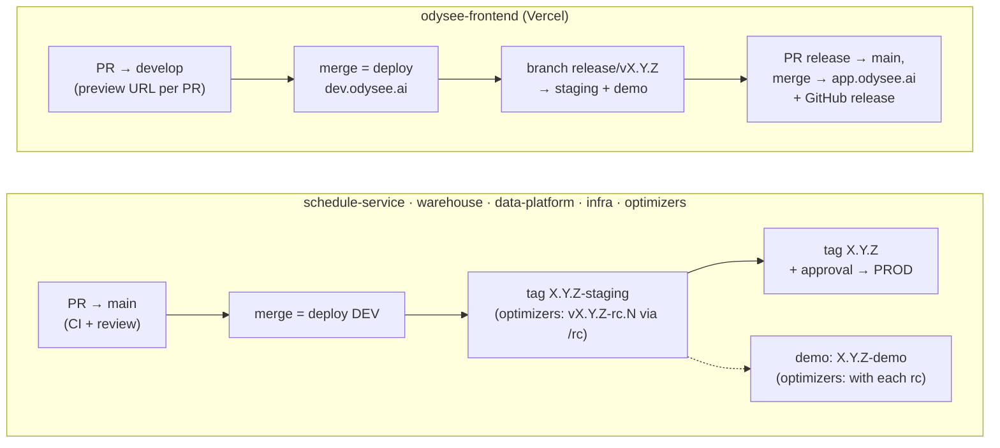

# 10 — How code ships, repo by repo

*Written 2026-11-03 from each repo's `.github/workflows`, `CODEOWNERS`, PR templates, AGENTS.md /
CLAUDE.md, READMEs and ADRs. Read the row for a repo before your first PR there. Confidence
markers: **[code]**, **[docs]**, **[inferred]**.*

**The headline:** five of the six deployable repos share one shape — *merge to `main` deploys
dev; a version tag deploys staging; a plain version tag deploys prod, behind an approval*. The
frontend is the exception, with a `develop` branch and release branches. `odysee-ds` doesn't ship
at all.

---

## The comparison

| | Branch you PR into | Dev deploys on | Staging / prod | What actually deploys | Approval to prod |
|---|---|---|---|---|---|
| **odysee-frontend** | `develop` (default branch is `main`!) | merge to `develop` → dev.odysee.ai; every PR gets a Vercel preview | push to `release/**` → staging + demo; merge the release PR into `main` → prod (`hotfix/*` → `main` for urgent fixes) | `vercel build` + `vercel deploy --prebuilt` from GitHub Actions; version taken from the release branch name | GitHub Environment `production` **[code]** |
| **schedule-service** | `main` | merge to `main` (doc/test-only changes skipped) | tags `X.Y.Z-staging`, `X.Y.Z-demo`, `X.Y.Z` | Docker image (tagged by SHA) → **migrations run as a one-off task first** → Terraform applies the ECS service. All from GitHub Actions | GitHub Environments; README: one approval + green CI, squash merges |
| **odysee-data-warehouse** | `main` | merge to `main` | tags `*-staging`, `*-demo`, `X.Y.Z` | Terraform apply from GitHub Actions in two steps: move the Databricks **git clone** to the ref, then apply the 160+ job definitions. "No image and no wheel. The unit of deployment is a git ref." | GitHub Environments **[code]**; apply is auto-approved (data-platform `adr/00002` context) |
| **odysee-data-platform** | `main` | merge to `main` | tags `X.Y.Z-staging`, `X.Y.Z`, `X.Y.Z-demo` | **Terraform Cloud** runs, as each tenant's principal; GitHub Actions only runs `ci.yml`. Code is uploaded as workspace files by the run | Terraform Cloud, per environment. ADR still "Proposed"; staging/prod not yet released (see 08) |
| **odysee-optimizers** | `main` | merge to `main` | comment **`/rc`** on the release-please PR → `vX.Y.Z-rc.N` → staging (+ demo); merge the release PR → `vX.Y.Z` → prod **only if its tree equals the last rc** | Databricks Asset Bundle (`databricks bundle deploy`) of a wheel | Protected GitHub Environments `prod` and `demo` |
| **odysee-infra** | `main` | merge to `main` → Terraform Cloud applies dev | release PR + tags `X.Y.Z-staging`, `X.Y.Z` → `release.yml` applies every workspace's saved plan | **Terraform Cloud** applies; the privileged stacks (`org`, `accounts`, `account-iam`, `tfc`) are applied **by a person, locally** | One approval per environment per release (`adr/00027`) |
| **odysee-ds** | `main` | — | — | Nothing ships from here; notebooks are run by hand in Databricks | — |

### Before you push

| Repo | Run locally | Enforced how |
|---|---|---|
| frontend | `pnpm run lint:fix`, `pnpm run format:check` (CLAUDE.md); CI also runs typecheck, build, tests | Husky hooks (`pre-commit`, `pre-push`, `commit-msg`) + **commitlint** |
| schedule-service | `./build.sh` (tests, coverage, ruff + mypy on an **allowlist of 57/120 files**) | pre-commit runs `build.sh`; widening `ruff`/`mypy` to the whole repo shows ~1,700 / ~90 findings |
| warehouse | ruff, black, isort, mypy per AGENTS.md; a Terraform plan on PRs touching `resources/` | CI + review against a strict AGENTS.md ("V2" rules for anything new) |
| data-platform | `make check` (255 unit tests in ~2 s, contracts, literals, config, Terraform fmt/validate/test) | CI, pre-commit, Terraform Cloud plan |
| optimizers | `uv run pytest` (1,107 tests, 80% coverage gate) + ruff + mypy strict; **use Python 3.12** (see 05) | CI; **PR title must be a Conventional Commit** |
| infra | `make check` (no credentials) | CI, OPA policies in Terraform Cloud, pre-commit |

### Who reviews (CODEOWNERS)

| Repo | Default owner |
|---|---|
| schedule-service | team `odysee-dev-be` |
| warehouse | team `databricks-team` |
| data-platform | `databricks-team`; `standard` contracts and `registry.ref` also need specific individuals |
| optimizers | specific individuals for `contracts/` and carrier configs |
| infra | two individuals for everything |
| frontend, ds | no CODEOWNERS file |

---

## Rules for commits and AI assistants (read this before using Claude in these repos)

| Repo | Commit / PR rules |
|---|---|
| **frontend** | Conventional Commits (commitlint). **No `Co-Authored-By` trailer for an AI assistant, no "Generated with…" footer.** Check `git config user.email` is your work address before the first commit. CLAUDE.md: never commit without explicit permission |
| **schedule-service** | **No AI co-author trailers or tool footers**; work email check |
| **warehouse** | **No AI co-author trailers or tool footers**; work email check; strict code rules (no `# noqa`, no wildcard imports, no docs files) |
| **data-platform** | Lower-case Conventional Commits (`<type>: <subject>`); **no AI attribution anywhere** |
| **optimizers** | Conventional Commit PR titles (CI-enforced, feeds release-please); no ticket numbers in code; never edit `CHANGELOG.md` |
| **infra** | No explicit commit rule found; PR template carries the isolation-invariant checklist every change is reviewed against |

**This matters for working with Claude.** Claude Code's default is to add an AI co-author trailer
and a "Generated with Claude Code" line to commits and PRs, as it has in this onboarding repo.
In the four repos above, that **violates the repo's rules**. Each repo's AGENTS.md / CLAUDE.md
should win, but say so explicitly when you ask Claude to commit there.

---

## Findings

1. **The frontend's default branch is `main`, but work goes to `develop`.** GitHub offers `main`
   as the PR target by default. The release jobs only fire for `release/*` and `hotfix/*` branches,
   so a feature merged straight into `main` wouldn't deploy. It would put untested code on the
   production branch and out of step with `develop`. Easy to get wrong on day one. **[code]**
2. **Broken links in schedule-service's README.** It sends readers to `docs/cicd.md` and
   `docs/branch-protection.md`, and the repo has no `docs/` folder. **[code]**
3. **Two Terraform models.** The newer repos (infra, data-platform) run Terraform in Terraform
   Cloud with short-lived credentials. schedule-service and the warehouse run it from GitHub
   Actions, the warehouse with a stored secret and auto-approved apply. Both repos record this
   as a deviation to fix, not a choice. **[docs]**
4. **Migrations before rollout** in schedule-service: the deploy runs `alembic upgrade head` as
   a separate Fargate task and only then rolls the service, so new code never runs against an
   old schema. Worth copying. **[code]**
5. **Prod deploys only what staging tested** in the optimizers: the prod tag must have the same
   tree as the last release candidate, or the deploy refuses. The strongest release guard in
   the company. **[code]**
6. **`odysee-ds` has no path to production**, which is consistent with 06's finding that model
   promotion is manual.

---

## A first-PR checklist

1. Find the repo's row above: which branch to target, which tag format releases it.
2. Read its AGENTS.md (and CLAUDE.md / CONTRIBUTING.md). They're short rulebooks and reviewers use
   them.
3. Run the local checks from "Before you push".
4. Title the PR as a Conventional Commit everywhere: frontend and optimizers enforce it,
   data-platform asks for it, and it costs nothing in the others.
5. If an AI assistant helped, keep its attribution out of commits and PRs in frontend,
   schedule-service, warehouse and data-platform.
6. Fill in the PR template where there is one (frontend, warehouse, data-platform, optimizers,
   infra).
