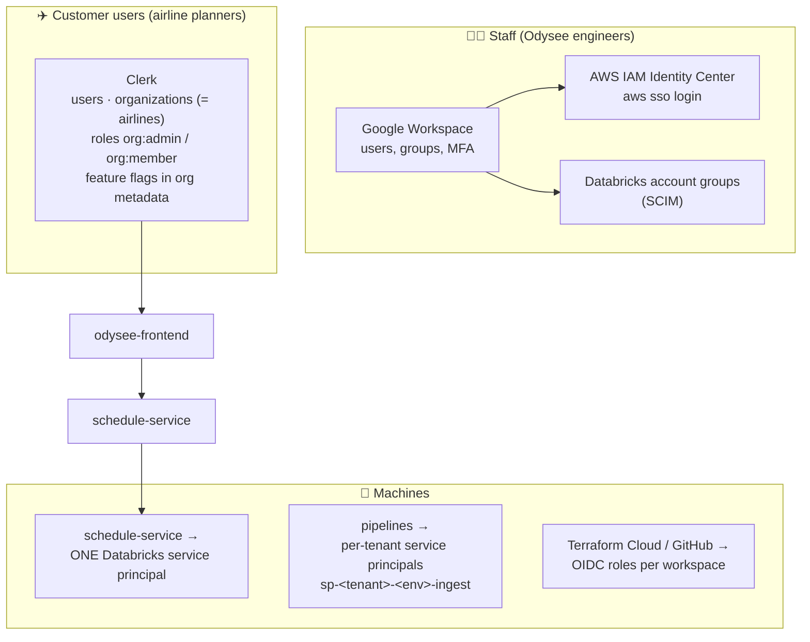
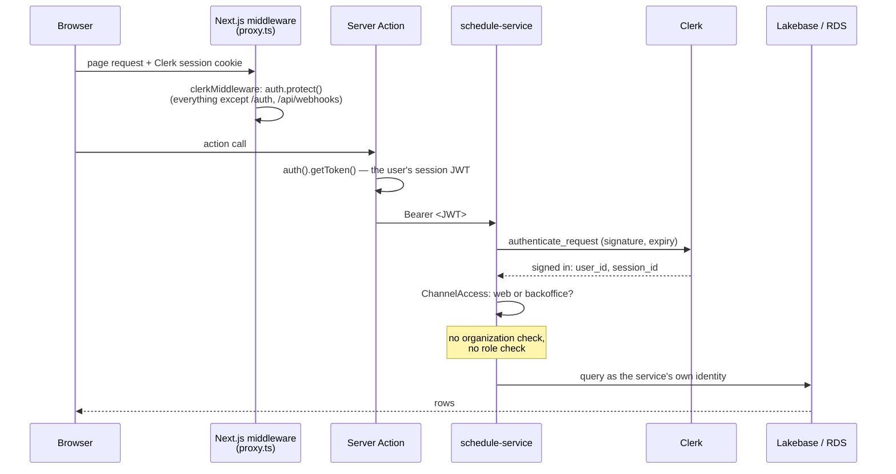
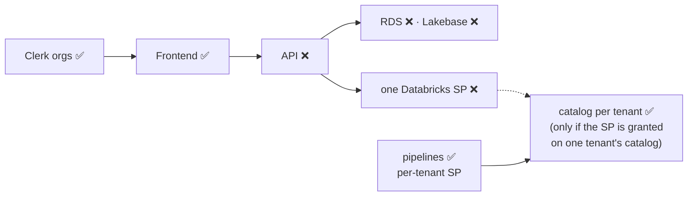

# 11 — Auth and tenancy, end to end

*Written 2026-11-03 from `odysee-frontend` (Clerk, admin, flags), `schedule-service` (`core/auth.py`,
`core/channels.py`, `middleware.py`, Databricks/Lakebase auth) and the infra and data-platform
material in [04](04-aws-infrastructure.md) and [08](08-data-platform-adapters.md). Confidence
markers: **[code]**, **[docs]**, **[inferred]**, **[config]** = decided in a dashboard, not in any
repo.*

**The short version:** there are three separate identity systems (staff, customers, machines).
Customer *identity* is solid, but **customer *isolation* stops at the frontend**. The API checks
that you're signed in, not who you belong to or what role you hold. The strong per-client walls
built in AWS and Databricks (04, 08) aren't carried through the serving layer.

---

## Layer 0: three identity systems

| System | Who | Where configured | Covered in |
|---|---|---|---|
| Google Workspace → Identity Center + Databricks SCIM | Staff | Google admin, `odysee-infra` | 04 |
| **Clerk** | Customer users, and Odysee staff using the app | Clerk dashboard **[config]** | this doc |
| Service principals and OIDC roles | Jobs, the API, CI | `odysee-infra`, `schedule-service/infra` | 04, 08, this doc |

---

## Layer 1: what happens on every request

**What the API checks** (`schedule-service/schedule_service/core/auth.py`, `middleware.py`) **[code]**:

1. The token is a valid **Clerk session token**, or an **OAuth token issued to one specific
   "backoffice" client** (`CLERK_BACKOFFICE_OAUTH_CLIENT_ID`). Everything else gets 401.
2. **Channel allow-list** (`core/channels.py`): web sessions may call **every** route. Backoffice
   tokens may call only two, the schedule list and the attribution toggle, and their non-GET calls
   are logged as "Backoffice change requested" (an audit line, not a block).
3. Then the handler runs. The resulting `AuthContext` holds only `user_id`, `session_id` and
   `channel`. The **organization and role that Clerk includes in a session token are never read.**

If you know Perl CGI apps, this is `REMOTE_USER` being set and no one ever consulting an ACL.

---

## Layer 2: roles exist, but only in the frontend

The frontend has a real role model (`apps/web/src/lib/admin.ts`) **[code]**:

| Role | Rule | Can |
|---|---|---|
| **Super admin** | member of the Odysee Clerk organization (`ODYSEE_ORG_ID`) with an admin role | Manage every organization: members, invites, roles, locks; global stats |
| **Org admin** | `org:admin` in their own organization | Manage their own organization's members |
| **Member** | `org:member` | Use the app |

Done properly where it's done: every admin **Server Action** calls its own guard
(`requireSuperAdmin`, `requireOrgAccess`, `requireAdmin`) rather than trusting the page that
renders the button. That matters because a Server Action is a public POST endpoint, callable
without ever loading the page.

**Feature flags** are resolved per organization (and per user) from Clerk metadata
(`apps/web/src/flags.ts`, see 07). That's how one customer sees Guest Disruptions and another
doesn't. It's a *visibility* switch in the UI: a hidden page's API routes still answer.

---

## Layer 3: where the tenant boundary is, and isn't

Following one question down the stack: *could a user from airline X see airline Y's data?*

| Layer | Separates customers? | Mechanism |
|---|---|---|
| Clerk | ✅ | Organizations, roles |
| Frontend pages and admin actions | ✅ | Org-scoped guards, per-org flags |
| **schedule-service API** | ❌ | Any valid session can call any route; org ignored |
| **App database (RDS)** | ❌ | `schedule` has no organization or customer column (see 09) |
| **Lakebase** | ❌ | One database (`databricks_postgres`), `public` schema, tables keyed by `schedule_id` only |
| **API → Databricks** | ❌ | One service principal for the whole API, OAuth `all-apis` scope |
| Pipelines (data-platform) | ✅ | Per-tenant principal on pinned compute, per-tenant catalog |
| Storage and catalogs (infra) | ✅ | Bucket, KMS key, IAM role, `ISOLATED` catalog per tenant; nightly isolation tests |

The isolation the infra team built so carefully (04) holds for **pipelines**. The serving path
reads around it: legacy `alaska_sierra_<env>` catalogs, one Lakebase database, one service
principal.

---

## Findings

1. **The API does authentication, not authorization.** Any valid Clerk session for this
   instance can call every route directly, including archiving schedules, toggling attribution and
   launching optimizer studies. Roles and organizations are enforced only in the frontend. A signed-in
   user can obtain their own session token (Clerk's browser SDK hands it to JavaScript via
   `getToken()`; that's how SPAs call APIs) and call the API with `curl`. The API is public (`NEXT_PUBLIC_API_URL`; the load
   balancer allows `0.0.0.0/0` in prod). **[code]**
2. **How serious finding 1 is depends on a Clerk setting not in any repo.** The sign-up page is a
   stock `<SignUp />`. If the Clerk instance allows open sign-up, anyone on the internet can get a
   session the API accepts, with no organization at all, and read every schedule and disruption in
   that environment, which in prod is Alaska's. If sign-up is invite-only (Clerk restricted mode),
   exposure is limited to invited users. **Check the Clerk dashboard first.** **[code + config
   unknown]**
3. **No customer dimension in the serving data** (from 09, now with the full picture): RDS and
   Lakebase have no organization column, and the API never filters by one. Fine while each
   environment has one real customer; not fine when a second arrives.
4. **One Databricks service principal for the whole API** (`core/databricks_oauth.py`,
   client-credentials with the `all-apis` scope). Whatever catalogs it's granted on, every API
   request can reach. That's the opposite of the per-tenant principals the pipelines use. Its
   actual grants aren't visible in the repos I have. **[code; grants unknown]**
5. **An unseen "backoffice" application** holds Clerk OAuth credentials for the API. It may only
   call two endpoints, but nothing in these repos says what it is, who uses it, or where its code
   lives. **[code; app unknown]**
6. **Done well:** admin Server Actions guard themselves; secrets live in AWS Secrets Manager with
   values loaded outside Terraform state; staff MFA is enforced at one place (Google Workspace);
   the browser never calls the API directly with a token in application code (it goes through
   Server Actions).

---

## What a fix would roughly involve [inferred]

Not a plan, just the shape, so the questions to the team are concrete:

- Read `org_id` / `org_role` from the Clerk token in `AuthContext` and refuse sessions with no
  organization.
- Give `schedule` (and anything keyed by `schedule_id`) an organization or tenant column, and
  filter every query by it, ideally once, in a shared dependency rather than per route.
- Mirror the frontend's admin/member roles for write routes (archive, attribution toggle, studies).
- Per tenant: scope the API's Databricks identity, or serve each tenant from its own catalog and
  Lakebase database, matching 04's model.
