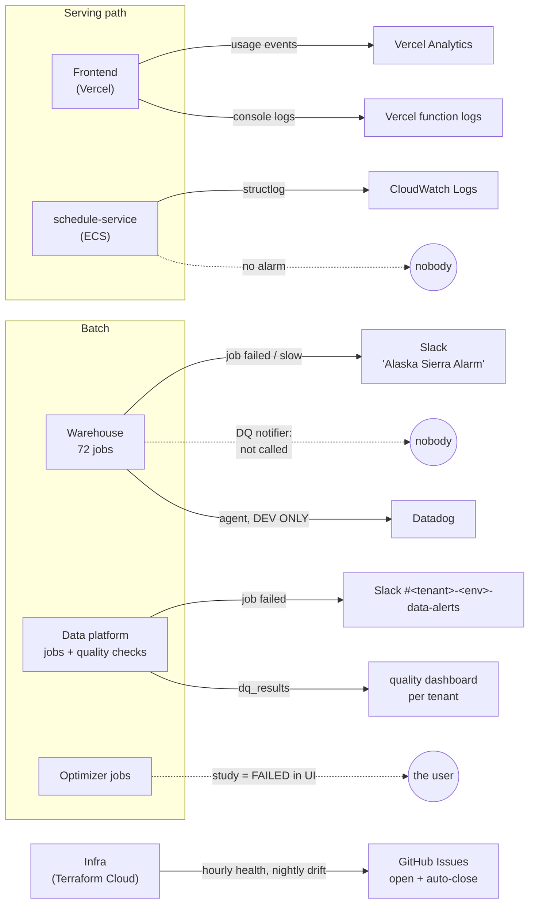

# 12 — Observability: logs, metrics and who gets told

*Written 2026-11-03 from the six deployable repos' Terraform, workflows and logging code, plus
infra `adr/00018`. Confidence markers: **[code]**, **[docs]**, **[inferred]**. Anything set up
directly in a SaaS dashboard (Vercel, Slack, an uptime checker) isn't visible to me; where that
could change a conclusion, I say so.*

**The short version:** monitoring grew per repo. Batch jobs report failures into Slack, and infra
reports into self-closing GitHub Issues. **Nothing in the repos alerts anyone when the production
API or website is down or erroring.** Datadog is the intended platform (`adr/00018`) but runs only
in dev.

---

## Layer 0: the map

If you've run a Perl shop where cron jobs mail failures to a list and nobody ever installed Nagios
on the web tier, this will feel familiar.

---

## Layer 1: component by component

| Component | Logs | Metrics / dashboards | Alerts → who |
|---|---|---|---|
| **Frontend** (Vercel) | `console` via a small logger (`packages/ui/lib/logger.ts`, whose own comment says Sentry "should replace the console"), visible in Vercel's function logs | **Vercel Analytics**: page views plus server-side product events (`track()`), enriched with user id, email, name and organization (`apps/web/src/lib/analytics.ts`, `app/actions/analytics/track.ts`) | None in the repo |
| **schedule-service** (ECS) | `structlog` → **CloudWatch Logs** (`awslogs` driver, `infra/modules/ecs-service/logs.tf`); RDS `postgresql` logs exported; Performance Insights kept 7 days | None defined | **None**: no `aws_cloudwatch_metric_alarm`, no Datadog, no error tracker. The load balancer's health check calls `/healthcheck`, which returns `{"pong": "ok"}` without touching the database, Lakebase or Databricks |
| **Warehouse** (72 Databricks jobs) | Databricks run history | Cost dashboard (`system.billing.usage`); model drift monitor (runs in dev, paused in staging/prod, see 06) | **Every job**: Slack destination "Slack Alaska Sierra Alarm" on failure *and* on slow-run warnings. **Data-quality (DQX)**: a notifier exists (P2/P3 → Slack, P0/P1 → PagerDuty), but **no pipeline calls it** (finding 2) |
| **Data platform** | Databricks run history | Per-tenant dashboard `dp-<tenant>-<env>-quality` over `quality.dq_results` | Per-tenant private Slack channel `#<tenant>-<env>-data-alerts` + emails (`adr/00009`); the contract gate refuses stale or wrong-version inputs |
| **Optimizers** | Databricks run history; progress JSON on a volume | Study status in the app | None to the team; a failed run surfaces to the **user** as a FAILED study |
| **Infra** | Terraform Cloud runs; Control Tower log archive | Unity Catalog system tables are the audit record of truth (`adr/00018`) | **GitHub Issues**: `tfc-ops` (hourly health) and `tfc-drift` (nightly) each open an Issue on a problem and close it when the next check is clean; nightly isolation tests run in GitHub Actions |
| *User notifications* | — | — | Novu tells the uploader when a schedule finishes or fails (03). That's product messaging, not operations |

---

## Layer 2: what the Datadog decision says vs. what exists

`odysee-infra/adr/00018` decides that Datadog is "the operational surface for the platform as
well as the application": AWS metrics through a per-account integration role, Databricks metrics
and job outcomes, alerting and dashboards for both. Its one hard rule: **no client data reaches
Datadog.**

| Planned | Built |
|---|---|
| Datadog AWS integration role in each account | Not found in `odysee-infra` |
| Databricks metrics and job outcomes | Agent on the warehouse's **dev** cluster only (`resources/datadog_agent.tf`); staging, prod and demo deliberately off |
| Application (API) monitoring | Nothing in `schedule-service` |
| "No client data" rule | **Enforced carefully** where the agent exists: Spark driver/worker logs explicitly disabled (exception messages quote row values), install script version-pinned, agent attached by cluster policy so it never lands on pipeline compute |

So the policy is thoughtful, but rollout has reached dev only.

---

## Findings

1. **Nothing alerts on the production API or website being down or failing.** schedule-service has
   no alarms, no error tracking and a health check that doesn't test its dependencies, so a broken
   Lakebase or Databricks connection still answers "ok". The frontend has no error tracking.
   Users would likely notice before the team. An external uptime monitor or Vercel alerting could
   exist outside the repos; ask. **[code; external tools unknown]**
2. **The warehouse's data-quality alerting isn't wired up.** `src/data_quality/notifier.py` routes
   P2/P3 failures to Slack `#data-quality-alerts` and P0/P1 *only* to PagerDuty. But it is called
   only from `data_quality/engine.py`, which no pipeline uses; the one pipeline that runs checks
   (`silver.hist_leg_load_factor_mix.py`) calls `DQValidator`, which never notifies. So today data-
   quality failures in the warehouse alert no one. If the notifier is switched on later, note
   its design: PagerDuty credentials come from a hand-made secret scope that no Terraform creates,
   and when they're missing it logs "skipping PagerDuty alert", so the *most* severe failures would
   be the ones that go silent. **[code]**
3. **Datadog is dev-only** (Layer 2). Prod has the policy but none of the telemetry.
4. **Two Slack schemes.** The warehouse posts all 72 jobs' failures and slow-run warnings to one
   destination named for Alaska. The data platform uses one private channel per tenant and
   environment. Worth asking which channel people actually watch, and whether slow-run warnings
   drown real failures. **[code; channel usage unknown]**
5. **Personal data goes to Vercel Analytics.** Every tracked product event carries the user's email
   and name and the organization's name. Probably acceptable for a B2B tool, but it's a question
   for whoever owns privacy and the customer DPAs. **[code; policy unknown]**
6. **Good patterns to reuse:** infra's self-closing GitHub Issues (one Issue per problem, closed by
   the next clean run, no alert fatigue); the data platform's per-tenant quality evidence table; the
   explicit Datadog data-boundary enforcement.

---

## If you wanted one first improvement [inferred]

A health check that actually touches its dependencies (`SELECT 1` against RDS and Lakebase), plus
one CloudWatch alarm on load-balancer 5xx rate and unhealthy hosts, routed to the channel people
watch. That's small Terraform in `schedule-service/infra`, and it closes finding 1 for the API.
