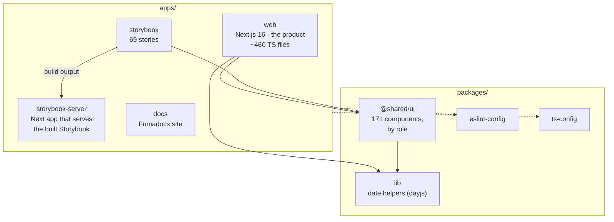
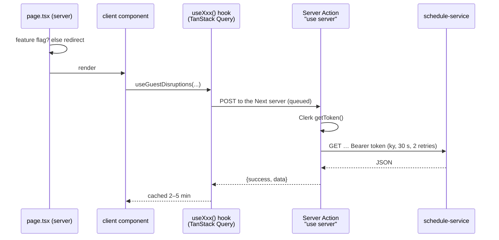

# 13 — Frontend architecture

*Written 2026-11-03 from `odysee-frontend` (`package.json`s, `apps/web/src`, `packages/ui`,
AGENTS.md) and the Next.js 16.3.4 package's own bundled docs. Confidence markers: **[code]**,
**[docs]**, **[inferred]**. Feature-level flows are in 03, 07 and 09; this is the skeleton they
hang on.*

**The short version:** a Turborepo + pnpm monorepo whose main app is Next.js 16 (App Router)
with MUI and TanStack Query. Its distinctive choice is that **every API read goes through a
Server Action**, which Next.js's own docs say runs one at a time per browser. The codebase is
orderly and well tested in places. Its written docs (README, CLAUDE.md, AGENTS.md) disagree with
each other and with `package.json`.

---

## Layer 0: the monorepo

Turborepo runs `build`, `lint`, `test` across packages with caching; pnpm workspaces link them
(`pnpm-workspace.yaml`: `apps/*`, `packages/*`). Node 24 (`.nvmrc`).

### The actual stack (from `package.json`, not the docs)

| | Version |
|---|---|
| Next.js | **16.3.4** (App Router) |
| React | 19.2 |
| TypeScript | 5.7 |
| MUI | 7.2 + Emotion |
| TanStack Query | 5.85 |
| Clerk | **7.0.12** |
| Zod | **4.3** |
| HTTP | ky |
| Feature flags | Vercel `flags` (values from Clerk metadata, see 07) |
| Tests | **Vitest** 4 + React Testing Library + MSW |
| Lint / format | ESLint 9 + Prettier (a `biome.json` exists but no script runs it) |

---

## Layer 1: anatomy of `apps/web/src`

| Folder | Holds | Notes |
|---|---|---|
| `app/(main)/…/page.tsx` | One route per product page: `connections/guest-disruptions`, `connections/connectivity-intelligence`, `optimisation/{constraint,schedule,gauge,fuel,fleet-availability}`, `reporting/impact-dashboard`, `schedules`, `admin/…`, `dashboard`, `network/overview` | Pages are **server components**: they check the feature flag, redirect if off, and render client components |
| `app/actions/<feature>/*.ts` | **53 Server Action files**: the whole data layer | Each builds a ky client with the user's Clerk token and calls schedule-service |
| `app/api/…/route.ts` | Only 2 route handlers: schedule upload token, Clerk webhook | |
| `components/<feature>/` | Feature UI (≈60% of `.tsx` files are `"use client"`) | |
| `hooks/<feature>/` | TanStack Query hooks wrapping the actions | Central query keys in `lib/query-keys` |
| `config/` | `api.ts` (every endpoint path), filter configs with Zod schemas, nav | |
| `providers/` | `QueryProvider` (2-min stale time, 1 retry), `CurrentScheduleProvider` (selected schedule, kept in `localStorage`), `DemoModeProvider`, `OdyseeAssistProvider` | |
| `flags.ts` | Per-feature flags resolved from Clerk org/user metadata | |
| `mocks/` | MSW handlers + per-endpoint switches; forced modules (see 05) | |
| `locales/` | en / de / es | Template leftovers (see findings) |

### How a page gets its data

**Uploads go another way.** The browser uploads the SSIM file directly to **Vercel Blob**
(`@vercel/blob/client`, up to 500 MB, `access: "public"`). The `app/api/schedules/upload` route
only issues the upload token. schedule-service then downloads the blob by URL
(`schedule_service/requests/vercel_blob.py`).

### The shared UI library

`packages/ui` (imported as `@shared/ui`) groups components by **role** rather than feature:
`animation`, `dialog`, `display`, `feedback`, `form-fields`, `inputs`, `layout`, `misc`,
`navigation`, `popover`. `pnpm run generate:component` scaffolds a new one into the right folder
and its barrel export. Storybook documents them (69 stories); `storybook-server` is a small Next
app that serves the built Storybook.

---

## Findings

1. **Every read is a Server Action, and Next.js runs those one at a time.** The docs bundled with
   the exact version in use (`next@16.3.4`, `dist/docs`) say: *"Next.js dispatches Server Actions
   one at a time per client. If a user triggers three actions in quick succession, the second
   waits for the first to finish, then the third waits for the second"* (`server-actions.md`), and
   *"Server Actions are queued. Using them for data fetching introduces sequential execution"*
   (`backend-for-frontend.md`). This app's pages fire several queries at once: Guest Disruptions
   loads the list, filter options and booking info together, so they queue behind each other, each
   also paying a Clerk token fetch and an API round trip. The bundled docs also carry a guide on
   client-side data fetching with TanStack Query (`client-side-data-fetching/tanstack-query.md`);
   the usual alternative is GET route handlers, or calling the API directly with the token. Which
   fits here is a team decision. **[code + docs; alternative inferred]**
2. **Customer schedule files are stored publicly and never deleted.** Uploads go to Vercel Blob with
   `access: "public"` (an unguessable URL, but no authentication), and neither the frontend nor
   schedule-service deletes them afterwards. These are airlines' unpublished future schedules,
   held at a third party outside the AWS accounts and their per-client encryption (04). A retention
   rule could exist in the Vercel dashboard; I can't see it. **[code; Vercel config unknown]**
3. **Three docs, three stacks, none current.** README and `.claude/CLAUDE.md` say Next 15.1, Clerk
   6.9.9, Zod 3.24 and **Jest**; AGENTS.md says Next 16.1.4 and Clerk 6.36.10; `package.json` has
   Next 16.3.4, Clerk 7.0.12, Zod 4.3 and Vitest. The README also lists 2 apps and 3 packages, out of
   4 and 4. `.claude/CLAUDE.md` is what Claude Code loads, so it actively misleads AI-assisted work
   (e.g. "write Jest tests"). **[code]**
4. **Template leftovers.** i18n is wired for en/de/es, but each locale holds two sample sentences
   from the starter template and one component uses translations, so the UI is hard-coded English.
   `biome.json` is present but unused. "Odysee Assist" is a side panel listing an O&D's scheduled and
   competitor flights, not an AI assistant, despite the name. **[code]**
5. **Server-first in principle, client-heavy in practice.** The project rules say to minimise
   `"use client"`; about 60% of `.tsx` files carry it. Normal for dashboard-style UIs built on MUI
   and TanStack Query, but worth knowing the rule and the code differ.
6. **Done well:** a single API client and endpoint registry; Zod-validated filters; admin Server
   Actions that guard themselves (11); MSW mocks switchable per endpoint, so UI work isn't blocked
   by the backend; a component generator enforcing the role-based layout; 64 test files.

---

## Where to start reading

1. `apps/web/src/app/(main)/connections/guest-disruptions/page.tsx` → its table component → the
   hook → the action. One feature end to end, 15 minutes (03 has the backend half).
2. `apps/web/src/lib/api-client.ts` and `config/api.ts`: the whole API surface in two files.
3. `AGENTS.md` sections "TanStack Query" and "Server Actions & API Layer". Trust its patterns,
   not its version table.
