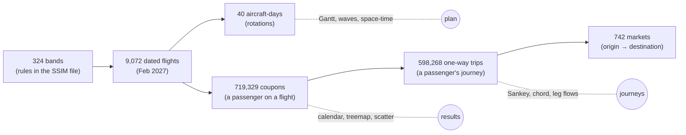

# 14 — Seeing the data: what the visualization sketches taught us

*Written 2026-11-21, after a long exploratory session. Confidence markers as elsewhere:
**[code]** read in a repo, **[computed]** produced by running our tools, **[inferred]** my reading.
Everything here is about the **synthetic airline** ("Odysee Air") that ships in
`odysee-data-warehouse/src/utilities/synthetic_airline`, not about a client.*

The aim was to understand the data as relationships, not tables, by drawing it many ways and seeing
which pictures taught something. This doc records the pictures, what each revealed, where each was
weak, and what we got wrong on the way.

---

## Layer 0: the one picture

Every sketch sits at one of these grains. The pictures that taught the most were the ones that put
**two grains in one frame**: the plan (flights, aircraft) with the results (passengers, money).

## Layer 1: the sketches

All pages live in `viz/`, carry their data inline in a `<script id="data">` block, and are rebuilt
by `tools/viz_data.py` (mode in the last column). Links are to the published artifacts.

| # | Page | Form | What it showed best | Weakness | Data mode |
|---|---|---|---|---|---|
| 1–3 | [Data Shapes](https://claude.ai/artifact/3fED7Q2MhpFCZqJrAUJpns) | time–station strings; unit grid + map; booking curve | banks; local vs flow on one flight; the fare ladder | band-to-flight expansion is flat (every band is daily) | default |
| 4 | [Hub Waves](https://claude.ai/artifact/TBrhXLyYDXeUrk1k6kDB4Y) | each aircraft as a wave, summed | a bank is phase alignment; GSO is banked, PIT smears | a teaching picture more than a tool | `--plan-only` |
| 5 | [Hub Clock](https://claude.ai/artifact/XffFq5b4voXgRYJjY99Kro) | 24-hour dial of connections | rhythm and near misses | hard to measure on a circle | `--plan-only` |
| 6 | [Hub Retimer](https://claude.ai/artifact/15jHksXfZFbQhu6rAW63BN) | clock + dial per flight | fixing a near miss is rarely free | counts connections, not value | `--plan-only` |
| 7 | [Journey Flows](https://claude.ai/artifact/PbZ8xq9b3A8pGp8D3zS5Rj) | Sankey | 20% of passengers connect but take 34% of seats | no time; hairball at airport level | `--journeys` |
| 8 | [Fare Split](https://claude.ai/artifact/XxX43SwdqY1iN64YMmoy8c) | Sankey, market → route | route revenue depends on the prorate rule | partial totals on the right | `--journeys` |
| 9 | [Load Calendar](https://claude.ai/artifact/XDQ5xJCNgH2yizqpqvekiQ) | calendar heat map, full year | week, seasons, holidays; Florida's opposite season | all of it is hard-coded multipliers | `--year` |
| 10 | [Hub Compass](https://claude.ai/artifact/21K5F2S1sARenFoadrAgwK) | chord diagram, compass order | "what is this hub for?" | striking but unreadable without hover | `--journeys` |
| 11 | [Network Treemap](https://claude.ai/artifact/PqG64JF9RwtcP6VeGoMHvM) | treemap | share of seats vs share of revenue | positions jump when the measure changes | `--loads` |
| 12 | [Flight Profiles](https://claude.ai/artifact/HPdYKrqjEpdXJfjc3VB2WB) | parallel coordinates | following one flight across 7 measures | only shows neighbouring axes | `--loads` |
| 13 | [Flight Scatter Matrix](https://claude.ai/artifact/V3YKPBeYf22WiyRwru9FDH) | scatterplot matrix | the *shape* of each relationship | 21 small charts | `--loads` |
| 14 | [Fleet Gantt](https://claude.ai/artifact/J7LTHiWg6wrULs26ZT9zPq) | rotation Gantt, enriched | plan and results together; retiming; study diff | desktop only; many features | `--gantt` |
| 15 | [Leg Flows](https://claude.ai/artifact/BTV6vWZT5NkowCJDwksX1q) | stacked bars + butterfly | where each route's passengers are really going | month totals only | `--journeys` |
| — | [Data Shapes 3D](https://claude.ai/artifact/7x3M5RfBRuk8UEaPyCSEnA) | five rotatable 3D sketches | memorable shapes (space-time block, vases) | cannot be read precisely | `--gantt` |

## Layer 2: what the data turned out to be

**[computed]** unless marked. Figures are February 2027 at full simulator scale.

- **Two hubs with different jobs.** Pittsburgh (29 aircraft) joins the East Coast to the Midwest;
  Greensboro (11 aircraft) joins the north to Florida. PIT is 72% of seats but 66% of revenue.
- **A bank is aircraft lined up in time.** GSO has four clean banks; PIT has one sharp morning bank
  (18 aircraft at 07:45) and then a rolling afternoon. In PIT's afternoon as many connecting
  passengers are in the terminal with fewer than half the aircraft, because they wait longer
  (113 min on average before 10:00, 133 after noon).
- **Connections mirror over a day, not at each turn.** On one out-and-back about 42% of the cities
  that feed the flight out are fed by the flight back. Over the whole day 576 airport-to-city
  connections work both ways and 97 one way only; for 48 of those the missing direction is a near
  miss.
- **Local vs flow is one fact seen three ways.** Connecting passengers are 20% of people, 26% of
  fares and 34% of seats.
- **A route's revenue is assembled by a rule.** The synthetic airline prorates by miles **[code]**
  (`synthetic_airline/warehouse_tables.py`, `coupon_cents`); the real leg-RASM pipeline uses the
  square root of revenue passenger miles **[code]** (`gold.fact_leg_rasm.py:302`). BOS→PIT earns
  $1.61M, $1.55M or $1.48M in the month depending on the rule.
- **Demand that did not fit is measurable in the simulator but not in the warehouse.** 36,887 seat
  requests were refused by a full flight, 76% of them on Greensboro's aircraft; 13,216 one-way
  trips found no seat at all (2.2%). We got this by subclassing the simulator in our tool.
- **An aircraft's day is worth $31k to $125k**, a fourfold range.
- **The fare taper.** Longer flights earn less per mile and more per seat (correlation −0.95 on log
  scales), so per-mile figures cannot be compared across stage lengths.

## Layer 3: what we learned about the forms

| Question | Form that answered it | Form that did not |
|---|---|---|
| What happens when, on which aircraft? | Gantt | chord, Sankey |
| How does a total split? | Sankey, treemap, stacked bars | scatter |
| What shape is the relationship? | scatterplot matrix | a correlation number |
| What repeats over time? | calendar heat map | treemap |
| What is this hub for? | leg flows, chord (with hover) | Gantt |

Three habits were worth more than any one chart:

1. **Check every sentence against the data.** Several of my first-draft notes were wrong
   (for example "sold-out flights are scattered"); the presets and recomputation showed it.
2. **Have someone else review.** An independent review of the Gantt reproduced every number but
   found an unsupported claim ("waiting is what the banks cost"), a misleading baseline and clipped
   marks.
3. **Use the control we have over synthetic data.** Sliding aircraft out of phase, retiming a
   flight, switching the prorate rule: the best insights came from changing something and watching.

## Known problems and corrections

- **39 → 40 aircraft.** One two-day cycle (via an overnight Denver trip) was first drawn as a single
  18-leg aircraft. `viz_data.py` now splits a rotation when the onward flight leaves before the
  current one lands. Earlier pages were rebuilt.
- **Same-aircraft connections.** Hub Clock, Hub Retimer and Hub Waves exclude staying on the same
  aircraft as a connection; the simulator allows it **[code]** (`network.py`, `paths`). That is 108
  flight pairs and about 5% of connecting passengers. The Gantt follows the simulator. The three
  older pages have **not** been corrected.
- **Our retiming model is ours.** A 30-minute minimum turn, knock-on only down the same aircraft,
  and nobody rebooks. None of that is in the simulator or checked against the optimizers.
- **Published pages cannot fetch a sibling data file** (it failed on the Gantt for reasons we did
  not find), so every page carries its data inline.
- **Untested corners.** Most pages were checked in a headless browser in the light theme only;
  dark theme, touch and keyboard access are largely unchecked. Details are in each commit message.

## Limits of the synthetic airline itself **[code]**

These decide how far any of the above transfers to a real customer. They are the starting list for
the next session (see `prompts/realistic-demo-data.md`).

- One month of schedule (February 2027); every band flies every day; one seat count per type and
  no cabins; connections are at most two legs.
- The week, the seasons, two holidays and Florida's season are fixed multiplier tables
  (`calendar.py`). Fares follow a square-root-of-distance formula with a five-step advance-purchase
  ladder (`simulate.py`, `_fare`).
- Seats are handed out in the order the simulator invents passengers, not in booking order, and
  markets are visited alphabetically, so who is refused on a full flight is arbitrary
  **[inferred]** (this is why DEN→PIT is 99% connecting).
- No cancellations after booking, no overbooking, no delays, no rebooking.
