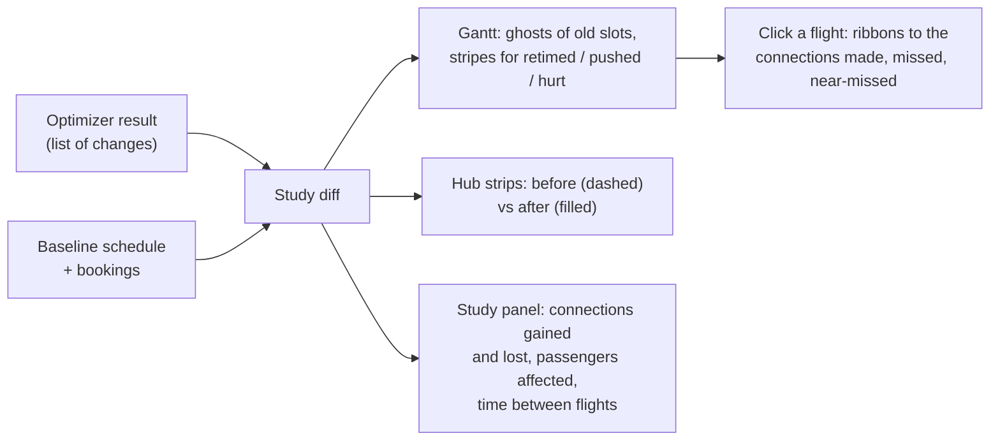

# 15 — Proposal: which visualizations belong in the product

*Written 2026-11-21. This is a proposal from an exploratory session on synthetic data, not a
design. It says nothing about where things go in the UX. Background and evidence are in
[14-data-visualizations.md](14-data-visualizations.md).*

## The recommendation in one table

| Tier | Visualization | Use in the product | Why |
|---|---|---|---|
| **1. Build first** | **Fleet Gantt as a study diff** | Explain any optimizer result: what moved, why, what it cost | Users already read rotation Gantts; it shows each change in passengers |
| 1 | **Hub strips** (aircraft on ground; passengers between flights), before and after | One-glance summary of a retiming study | Reads without training; shows longer or shorter waits |
| 1 | **Connection ribbons on a selected flight** | "Why this move?" for a single suggestion | Turns a number into a visible near miss becoming a connection |
| **2. Build next** | **Out-and-back view and one-way holes** | Manual planning; quality check on constraint studies | Computed from the schedule alone, so it works on any output |
| 2 | **Bars as containers with unmet-demand caps** | Gauge studies | The two things gauge is about, on the chart users know |
| 2 | **Leg Flows** | Route reviews: destination or stepping stone? | Clear at a glance, city detail one click away |
| 2 | **Load Calendar** | Seasonality; which days a route is short of seats | A year in one frame |
| **3. Supporting** | **Fare Split** | Show a revenue claim under more than one prorate rule | Makes an assumption visible that is usually hidden |
| 3 | **Scatterplot matrix** | Analyst exploration | Shows shapes a table hides |
| **Explain, don't ship** | Hub Waves, Hub Clock, 3D sketches | Onboarding, sales, teaching what a bank is | Memorable, but not working tools |
| **Drop** | Chord, Sankey of journeys, treemap, parallel coordinates | — | Each was beaten by a simpler form for the same question |

## Tier 1 in more detail

A prototype exists: on the [Fleet Gantt](https://claude.ai/artifact/J7LTHiWg6wrULs26ZT9zPq) press
**Load example study**. The example is a greedy stand-in built in the page (15 retimes of up to 15
minutes), **not** an optimizer result. On it the schedule gains 36 connections and loses none, but
passengers spend more time between flights (8,969 → 9,047 passenger-hours on one day). A count of
connections alone would have hidden that trade, which is the argument for showing both.

**What a real integration needs**

| Need | Today in the prototype | For the product |
|---|---|---|
| The changes | flight id + minutes moved | optimizer output, including cancellations and aircraft swaps (not representable yet) |
| Legality rules | the simulator's (35/60 min MCT, 4 h, 1.5× circuity) | the engine's own rules, per carrier, terminal and aircraft |
| Knock-on | my assumption: 30-minute minimum turn | whatever the optimizer enforced |
| Passengers affected | bookings on the old schedule; nobody rebooks | disruption logic from Guest Disruptions |
| Value | every connection counts as one | the revenue model's figures, shown under stated assumptions |
| Unmet demand | recorded by instrumenting the simulator | a demand or spill model; this is a real dependency, not a chart |

## Risks

- **Everything was judged on synthetic data** with a uniform daily schedule. Real schedules have
  weekday bands, multi-day rotations and several fleet types. I expect the Gantt and calendar to
  hold up and the dense overlays (ribbons at a large hub) to need filtering.
- **Scale.** 40 aircraft fit on a page; a real fleet of several hundred needs grouping, filtering
  or a focus-plus-context design.
- **Colour.** Red-to-green on the calendar and the status colours on the Gantt were chosen for
  speed of reading and were not checked for colour-blind readers.
- **The Gantt has accreted features.** Before it becomes a product surface it needs a pass to
  decide what is on by default.

## Suggested order of work

1. Make the demo data realistic enough to stress these (see `prompts/realistic-demo-data.md`).
2. Run a real optimizer on that schedule and load its result into the study diff.
3. Put the Tier 1 views in front of a planner and watch what they try to do.
4. Only then decide on Tier 2.
